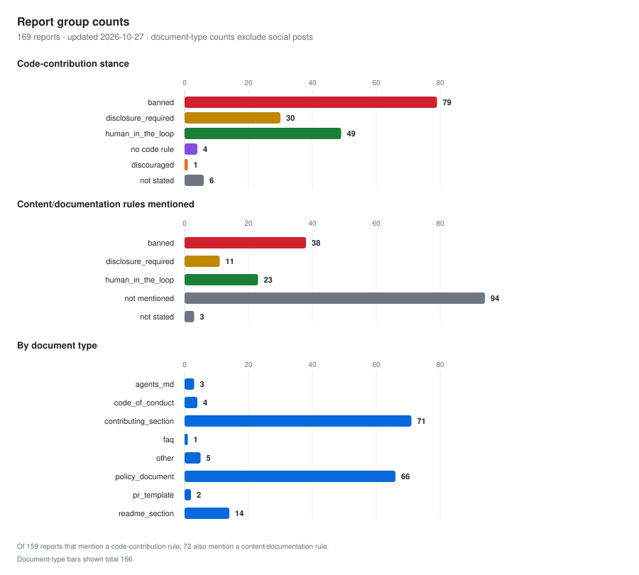
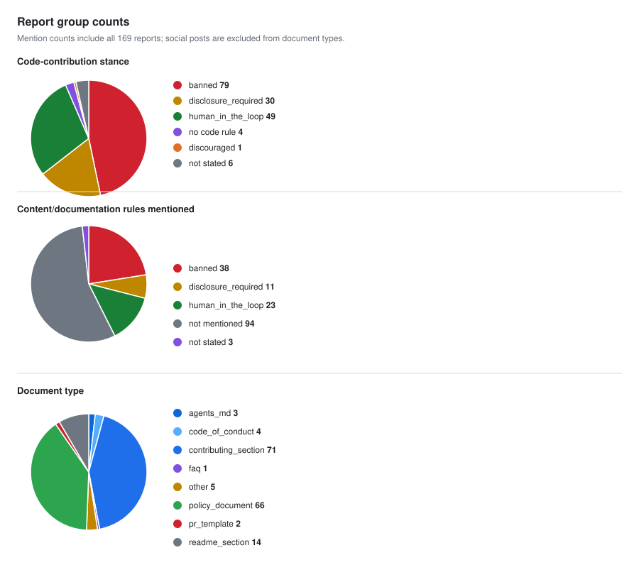
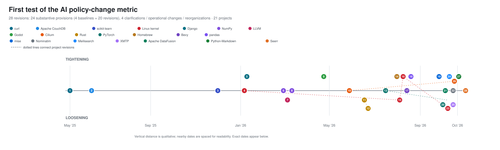
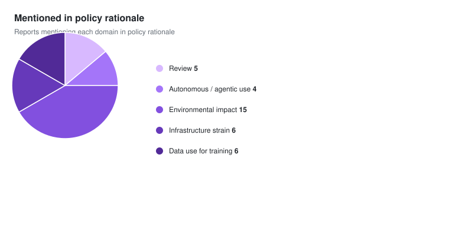

# AI policy coverage summary: 169 projects

This index contains 169 uniquely named projects and 169 linked reports. Report snapshots have different dates; the newest project reports are dated 2026-10-21. Summary charts were generated 2026-10-22.

The taxonomy below maps to the CHAOSS AI specificity [metric found here](https://github.com/chaoss/wg-ai-alignment/blob/main/metrics/ai-alignment-community-governed-use/ai-use-consent-policy-specificity.md#taxonomy-of-domains).

🟥 **1** Code contributions · 🟧 **2** Notetaker and meeting bots · 🟨 **3** Content and documentation · 🟩 **4** Moderation and enforcement · 🟦 **5** Review of contributions · 🟪 **6** Autonomous and agentic use · 🟫 **7** Environmental impact · ⬛ **8** Infrastructure strain · ⬜ **9** Data use for training

`X` specific rule: supervision plus at least one other specificity attribute (scope, accountability, or proportionality) · `~` partial: only one specificity attribute, or the domain is covered only by general wording · `R` rationale mention, not a rule · blank: no rule found in the scanned document. This scoring boundary is this project's interpretation, not a threshold defined by the CHAOSS metric.

| Project | 🟥 1 | 🟧 2 | 🟨 3 | 🟩 4 | 🟦 5 | 🟪 6 | 🟫 7 | ⬛ 8 | ⬜ 9 | |
|---|:-:|:-:|:-:|:-:|:-:|:-:|:-:|:-:|:-:|---|
| afnix | ~ |  |  |  |  |  |  |  |  | [view report][p1] |
| Alacritty | X |  | ~ |  |  |  |  |  |  | [view report][p2] |
| Allium | X |  |  | ~ |  |  |  |  |  | [view report][p3] |
| Amberol | X |  | X |  |  |  |  |  |  | [view report][p4] |
| apache | X |  | X |  |  | ~ |  |  |  | [view report][p5] |
| Apache Airflow | X |  |  | X |  |  |  |  |  | [view report][p6] |
| Apache CouchDB | X |  | ~ |  |  |  |  |  |  | [view report][p7] |
| Apache DataFusion | X |  |  |  |  | R |  |  |  | [view report][p8] |
| Apache Kvrocks | X |  | ~ | ~ |  | ~ |  |  |  | [view report][p9] |
| Apache PouchDB | X |  | ~ |  |  |  |  |  |  | [view report][p10] |
| Arcalibre | ~ |  |  |  |  |  | R |  | R | [view report][p11] |
| Arrow | X |  |  | ~ | X | X |  |  |  | [view report][p12] |
| Asahi Linux | X |  |  | ~ |  | R | R |  |  | [view report][p13] |
| astropy/astropy-project | X |  | ~ |  |  | X |  |  |  | [view report][p14] |
| Avoyd | ~ |  |  |  |  |  |  |  |  | [view report][p15] |
| Bevy | X |  | X | X | ~ | ~ |  |  |  | [view report][p16] |
| Bobby | X |  | ~ |  |  |  |  |  |  | [view report][p17] |
| borgmatic | X |  |  |  |  | X |  |  |  | [view report][p18] |
| CapyPDF | X |  |  | ~ |  |  |  |  |  | [view report][p19] |
| castle-game-engine | X |  | ~ |  | X | X |  |  |  | [view report][p20] |
| Cataclysm: Dark Days Ahead | X |  |  |  |  |  |  |  |  | [view report][p21] |
| CC Open Source | X |  | ~ |  |  |  |  |  |  | [view report][p22] |
| CCExtractor | X |  |  | ~ | X | ~ |  |  |  | [view report][p23] |
| Cheese Paper | X |  |  |  |  |  |  |  |  | [view report][p24] |
| chezmoi | X |  |  | ~ |  |  |  |  |  | [view report][p25] |
| Chimera Linux | ~ |  |  |  |  |  |  |  |  | [view report][p26] |
| ChiPass | ~ |  |  |  |  |  |  |  |  | [view report][p27] |
| cilium | X |  | X | ~ | ~ |  |  |  |  | [view report][p28] |
| Clojure | X |  |  |  | ~ |  |  |  |  | [view report][p29] |
| CloudNativePG | X |  | ~ | ~ |  | ~ |  |  |  | [view report][p30] |
| codeberg | X |  |  | ~ |  | R | R | R | R | [view report][p31] |
| conda | X |  |  | ~ | X | X |  |  |  | [view report][p32] |
| CPython | X |  | ~ | ~ |  |  |  |  |  | [view report][p33] |
| CuPy | X |  |  | ~ |  |  |  |  |  | [view report][p34] |
| curl | X |  | ~ | ~ |  |  |  |  |  | [view report][p35] |
| DataJourneyHQ | X |  |  |  | R |  |  |  |  | [view report][p36] |
| debian | ~ |  | ~ | ~ | R | X | R | R |  | [view report][p37] |
| Decker | X |  |  |  |  |  |  |  |  | [view report][p38] |
| Django | X |  | ~ | ~ | X | X |  |  |  | [view report][p39] |
| dlt | X |  |  | ~ |  | X |  |  |  | [view report][p40] |
| do | X |  |  | ~ |  |  |  |  |  | [view report][p41] |
| Drupal | X |  | ~ | X | ~ | R |  |  |  | [view report][p42] |
| Dune 3D | X |  |  |  |  |  |  |  |  | [view report][p43] |
| EasyBuild | X | ~ | X |  | X |  |  |  |  | [view report][p44] |
| Elastic | X |  | X |  |  |  |  |  |  | [view report][p45] |
| Elementary OS | X |  | X |  |  |  | R |  |  | [view report][p46] |
| EmulatorKit | ~ |  |  |  |  |  |  |  |  | [view report][p47] |
| Endless Sky | X |  | ~ |  |  |  |  |  |  | [view report][p48] |
| Evi | X |  |  | ~ |  |  |  |  |  | [view report][p49] |
| Exim | ~ |  |  |  |  |  |  |  |  | [view report][p50] |
| FastAPI | X |  |  | ~ |  | ~ |  |  |  | [view report][p51] |
| Fedify | X |  | X | ~ |  |  |  |  |  | [view report][p52] |
| Fedora | X |  | X | X | X | ~ |  | ~ |  | [view report][p53] |
| Fennel | X |  |  | ~ |  |  |  |  | X | [view report][p54] |
| Firefox | X |  |  |  | X |  |  |  |  | [view report][p55] |
| Flutter | ~ |  |  |  |  |  |  |  |  | [view report][p56] |
| forgejo | X |  | X |  | ~ | X |  |  |  | [view report][p57] |
| Fractal | X |  | X |  |  |  | R |  | R | [view report][p58] |
| gaypanel | ~ |  |  |  |  |  |  |  |  | [view report][p59] |
| gcc | X |  |  |  | ~ | ~ |  |  |  | [view report][p60] |
| gdal-site | X |  |  |  | R | ~ |  |  |  | [view report][p61] |
| Gedit | X |  | ~ |  |  |  |  |  |  | [view report][p62] |
| gentoo | ~ |  |  |  |  |  | R |  |  | [view report][p63] |
| ghostty-org/ghostty | ~ |  | ~ | ~ |  |  |  |  |  | [view report][p64] |
| GIMP | X |  | ~ |  |  |  |  |  |  | [view report][p65] |
| Gitte | X |  |  |  |  |  |  |  |  | [view report][p66] |
| Glasgow Interface Explorer | X |  |  |  |  |  |  |  |  | [view report][p67] |
| GNOME Extensions | X |  |  | ~ |  |  |  |  |  | [view report][p68] |
| GNOME Loupe | X |  | X |  |  |  |  |  |  | [view report][p69] |
| go-gitea/gitea | X |  |  | ~ |  |  |  |  |  | [view report][p70] |
| godot | X |  | ~ | ~ | ~ | ~ |  |  |  | [view report][p71] |
| goose | X |  |  | ~ | X | ~ |  |  |  | [view report][p72] |
| GoToSocial | X |  | ~ |  |  |  |  |  |  | [view report][p73] |
| Gram | X |  | ~ | X |  |  |  |  |  | [view report][p74] |
| Halloy | X |  | ~ |  |  |  |  |  |  | [view report][p75] |
| Highscore | X |  | X |  |  |  |  |  |  | [view report][p76] |
| Homebrew | X |  |  |  | ~ |  |  |  |  | [view report][p77] |
| Icechunk | X |  | X | ~ | ~ | X |  |  |  | [view report][p78] |
| Idris | X |  |  |  |  | X |  |  |  | [view report][p79] |
| Inkscape |  |  |  |  |  |  |  |  |  | [view report][p80] |
| Inochi2D | X |  | ~ | ~ |  |  |  |  |  | [view report][p81] |
| IREE (Intermediate Representation Execution Environment) | X |  | ~ |  |  | X |  |  |  | [view report][p82] |
| jazzband/pip-tools | X |  |  | ~ |  | ~ |  |  |  | [view report][p83] |
| jellyfin/jellyfin.org | X |  |  | ~ |  | X |  |  |  | [view report][p84] |
| Joomla | X |  | ~ | ~ |  |  |  |  |  | [view report][p85] |
| Jqwik | X |  |  |  |  |  |  |  |  | [view report][p86] |
| jsoup | X |  |  |  |  |  |  |  |  | [view report][p87] |
| kde-gsoc | ~ |  |  |  |  |  | R |  |  | [view report][p88] |
| keepassxreboot/keepassxc | ~ |  |  |  |  |  |  |  |  | [view report][p89] |
| Kornia | ~ |  |  |  |  |  |  |  |  | [view report][p90] |
| Kubernetes | X |  | ~ | ~ | ~ |  |  |  |  | [view report][p91] |
| Leiningen | ~ |  |  |  |  |  |  |  |  | [view report][p92] |
| libadwaita | X |  | X |  |  |  |  |  |  | [view report][p93] |
| libmanette | X |  | X |  |  |  |  |  |  | [view report][p94] |
| libxml2 | X |  |  |  |  |  |  |  |  | [view report][p95] |
| Lighthouse | X |  |  | ~ |  | ~ |  |  |  | [view report][p96] |
| LinkML | X |  | ~ |  | X | X |  |  |  | [view report][p97] |
| linux-foundation | X |  | ~ |  | R |  |  |  | R | [view report][p98] |
| llvm/llvm-project | X |  | X | ~ | ~ | ~ |  |  |  | [view report][p99] |
| Lobsters | X |  |  |  |  |  |  |  |  | [view report][p100] |
| LÖVE | X |  |  |  |  |  |  |  |  | [view report][p101] |
| mastodon/.github | X |  | ~ |  | X | X |  |  |  | [view report][p102] |
| matplotlib/matplotlib | X |  |  | ~ |  | ~ |  |  |  | [view report][p103] |
| MDAnalysis | X |  | X | ~ | X | X |  |  |  | [view report][p104] |
| Mesa | X |  |  |  | X | X |  |  |  | [view report][p105] |
| mGBA | X |  |  | ~ |  |  |  |  |  | [view report][p106] |
| MicroPython | X |  |  | ~ |  | X |  |  |  | [view report][p107] |
| Mikan | X |  |  |  |  |  |  |  |  | [view report][p108] |
| Molecular Nodes | X |  | X | X | X | X |  |  |  | [view report][p109] |
| napari | X |  |  | ~ |  | X |  |  |  | [view report][p110] |
| NetBSD | X |  |  |  |  |  |  |  |  | [view report][p111] |
| nlnet-labs | X |  | ~ |  | X |  |  |  |  | [view report][p112] |
| NumPy | X |  |  | ~ |  | X |  |  |  | [view report][p113] |
| nvim-tree | X |  | ~ | ~ | X | ~ |  |  |  | [view report][p114] |
| OCaml | X |  |  |  | ~ |  |  |  |  | [view report][p115] |
| OkHttp | X |  | ~ | ~ |  |  |  |  |  | [view report][p116] |
| Open edX | X |  | ~ | ~ | X | ~ |  |  |  | [view report][p117] |
| openinfra | X |  | ~ |  |  | ~ |  |  |  | [view report][p118] |
| OpenJDK | X |  | X | ~ | X |  |  |  |  | [view report][p119] |
| OpenTTD | X |  |  | ~ |  | ~ |  |  |  | [view report][p120] |
| OSGeo/gdal | X |  |  | ~ | R | X |  | R |  | [view report][p121] |
| OSGeo/PROJ | X |  | ~ | ~ | ~ | ~ |  |  |  | [view report][p122] |
| oxide | X |  | X |  | ~ |  |  |  | ~ | [view report][p123] |
| Pallets | X |  | ~ | ~ | ~ |  | R |  |  | [view report][p124] |
| Pandas | X |  | ~ | ~ | ~ |  |  |  |  | [view report][p125] |
| Pandemonium Engine | X |  | X |  |  |  | R |  |  | [view report][p126] |
| pgwatch | X |  |  | ~ | ~ |  |  |  |  | [view report][p127] |
| pip | X |  |  | ~ |  | X |  |  |  | [view report][p128] |
| pkgconf | X |  |  | ~ |  | X |  |  |  | [view report][p129] |
| Poezio | X |  | ~ |  |  |  |  |  |  | [view report][p130] |
| pola-rs/polars | ~ |  | ~ |  | ~ | ~ |  |  |  | [view report][p131] |
| Polyphony | X |  | X | X |  |  | R |  | R | [view report][p132] |
| postmarketos | ~ |  |  |  |  |  | R | R |  | [view report][p133] |
| Processing/p5.js | X |  | ~ | ~ | X | X | R |  |  | [view report][p134] |
| Pytest | X |  |  | ~ |  | X |  |  |  | [view report][p135] |
| python-attrs/attrs | ~ |  |  |  |  |  |  |  |  | [view report][p136] |
| PyTorch | X |  |  | ~ | ~ |  |  |  |  | [view report][p137] |
| PyVista | X |  | ~ |  |  | ~ |  | ~ |  | [view report][p138] |
| qemu/qemu | X |  |  |  |  |  |  |  |  | [view report][p139] |
| qgis/QGIS-Enhancement-Proposals | X |  | X | ~ | ~ | ~ |  | R |  | [view report][p140] |
| qutip | X |  | ~ | ~ | X | X |  |  |  | [view report][p141] |
| Redox OS | X |  |  | ~ |  |  |  |  |  | [view report][p142] |
| Requests | X |  |  | ~ | X | X |  |  |  | [view report][p143] |
| rust | X |  | X | ~ | X | ~ | R |  |  | [view report][p144] |
| Schism Tracker | X |  |  |  | ~ |  |  |  |  | [view report][p145] |
| SciActive | X |  | X | ~ |  | X |  |  | R | [view report][p146] |
| scikit-image | X |  |  |  |  |  |  |  |  | [view report][p147] |
| scikit-learn/scikit-learn | ~ |  |  | ~ | ~ |  |  |  |  | [view report][p148] |
| SciPy | X |  |  | ~ |  | X |  |  |  | [view report][p149] |
| SDL | X |  |  |  |  |  |  |  |  | [view report][p150] |
| SDL_net | X |  |  |  |  |  |  |  |  | [view report][p151] |
| SearXNG | X |  | ~ | ~ |  |  |  |  |  | [view report][p152] |
| Sentinel | X |  |  | X |  |  |  |  |  | [view report][p153] |
| servo/book | X |  | ~ | ~ | ~ |  | R |  |  | [view report][p154] |
| Smederee | X |  |  |  |  |  |  |  |  | [view report][p155] |
| snac | X |  |  |  |  |  |  |  |  | [view report][p156] |
| Sphinx | X |  |  | ~ |  | X |  |  |  | [view report][p157] |
| STAC | X |  | X | X | X | X |  |  |  | [view report][p158] |
| stb | X |  | ~ |  |  |  |  |  |  | [view report][p159] |
| sunpy/sunpy | ~ |  | ~ |  |  |  |  |  |  | [view report][p160] |
| SymPy | X |  |  | ~ |  |  |  |  |  | [view report][p161] |
| teamtype/teamtype | ~ |  | ~ |  |  |  |  |  |  | [view report][p162] |
| Telegraf | X |  |  |  |  |  |  |  |  | [view report][p163] |
| Tenacity | X |  |  | ~ |  |  |  | R |  | [view report][p164] |
| TorchGeo | X |  | ~ | ~ |  | X |  |  |  | [view report][p165] |
| torvalds/linux | X |  |  |  |  | X |  |  |  | [view report][p166] |
| Tusky | X |  |  |  |  |  |  |  |  | [view report][p167] |
| yt-dlp/yt-dlp | ~ |  |  |  | ~ | ~ |  |  |  | [view report][p168] |
| zulip/zulip | X |  |  |  |  |  |  |  |  | [view report][p169] |

[p1]: afnix/2026-08-30.md
[p2]: alacritty/2026-10-21.md
[p3]: allium/2026-10-21.md
[p4]: amberol/2026-10-21.md
[p5]: apache/2026-08-30.md
[p6]: apache-airflow/2026-10-21.md
[p7]: apache-couchdb/2026-10-21.md
[p8]: apache-datafusion/2026-10-21.md
[p9]: apache-kvrocks/2026-10-21.md
[p10]: apache-pouchdb/2026-10-21.md
[p11]: arcalibre/2026-10-21.md
[p12]: arrow/2026-10-21.md
[p13]: asahi-linux/2026-10-21.md
[p14]: astropy-astropy-project/2026-08-30.md
[p15]: avoyd/2026-10-21.md
[p16]: bevy/2026-10-21.md
[p17]: bobby/2026-10-21.md
[p18]: borgmatic/2026-10-21.md
[p19]: capypdf/2026-10-21.md
[p20]: castle-game-engine/2026-08-30.md
[p21]: cataclysm-dark-days-ahead/2026-10-21.md
[p22]: cc-open-source/2026-10-21.md
[p23]: ccextractor/2026-10-21.md
[p24]: cheese-paper/2026-10-21.md
[p25]: chezmoi/2026-10-21.md
[p26]: chimera-linux/2026-10-21.md
[p27]: chipass/2026-10-21.md
[p28]: cilium/2026-10-21.md
[p29]: clojure/2026-10-21.md
[p30]: cloudnativepg/2026-10-21.md
[p31]: codeberg/2026-08-31.md
[p32]: conda/2026-10-21.md
[p33]: cpython/2026-10-21.md
[p34]: cupy/2026-10-21.md
[p35]: curl/2026-10-21.md
[p36]: datajourneyhq/2026-10-21.md
[p37]: debian/2026-08-30.md
[p38]: decker/2026-10-21.md
[p39]: django/2026-10-21.md
[p40]: dlt/2026-10-21.md
[p41]: do/2026-10-21.md
[p42]: drupal/2026-10-21.md
[p43]: dune-3d/2026-10-21.md
[p44]: easybuild/2026-10-21.md
[p45]: elastic/2026-10-21.md
[p46]: elementary-os/2026-10-21.md
[p47]: emulatorkit/2026-10-21.md
[p48]: endless-sky/2026-10-21.md
[p49]: evi/2026-10-21.md
[p50]: exim/2026-10-21.md
[p51]: fastapi/2026-10-21.md
[p52]: fedify/2026-10-21.md
[p53]: fedora/2026-10-21.md
[p54]: fennel/2026-10-21.md
[p55]: firefox/2026-10-21.md
[p56]: flutter/2026-10-21.md
[p57]: forgejo/2026-08-30.md
[p58]: fractal/2026-10-21.md
[p59]: gaypanel/2026-10-21.md
[p60]: gcc/2026-08-30.md
[p61]: gdal-site/2026-08-30.md
[p62]: gedit/2026-10-21.md
[p63]: gentoo/2026-08-30.md
[p64]: ghostty-org-ghostty/2026-08-30.md
[p65]: gimp/2026-10-21.md
[p66]: gitte/2026-10-21.md
[p67]: glasgow-interface-explorer/2026-10-21.md
[p68]: gnome-extensions/2026-10-21.md
[p69]: gnome-loupe/2026-10-21.md
[p70]: go-gitea-gitea/2026-08-30.md
[p71]: godot/2026-08-31.md
[p72]: goose/2026-10-21.md
[p73]: gotosocial/2026-10-21.md
[p74]: gram/2026-10-21.md
[p75]: halloy/2026-10-21.md
[p76]: highscore/2026-10-21.md
[p77]: homebrew/2026-10-21.md
[p78]: icechunk/2026-10-21.md
[p79]: idris/2026-10-21.md
[p80]: inkscape/2026-10-21.md
[p81]: inochi2d/2026-10-21.md
[p82]: iree/2026-10-21.md
[p83]: jazzband-pip-tools/2026-08-30.md
[p84]: jellyfin-jellyfin-org/2026-08-30.md
[p85]: joomla/2026-10-21.md
[p86]: jqwik/2026-10-21.md
[p87]: jsoup/2026-10-21.md
[p88]: kde-gsoc/2026-08-30.md
[p89]: keepassxreboot-keepassxc/2026-08-30.md
[p90]: kornia/2026-10-21.md
[p91]: kubernetes/2026-10-21.md
[p92]: leiningen/2026-10-21.md
[p93]: libadwaita/2026-10-21.md
[p94]: libmanette/2026-10-21.md
[p95]: libxml2/2026-10-21.md
[p96]: lighthouse/2026-10-21.md
[p97]: linkml/2026-10-21.md
[p98]: linux-foundation/2026-08-30.md
[p99]: llvm-llvm-project/2026-08-30.md
[p100]: lobsters/2026-10-21.md
[p101]: love2d/2026-10-21.md
[p102]: mastodon-github/2026-08-30.md
[p103]: matplotlib-matplotlib/2026-08-30.md
[p104]: mdanalysis/2026-10-21.md
[p105]: mesa/2026-10-21.md
[p106]: mgba/2026-10-21.md
[p107]: micropython/2026-10-21.md
[p108]: mikan/2026-10-21.md
[p109]: molecular-nodes/2026-10-21.md
[p110]: napari/2026-10-21.md
[p111]: netbsd/2026-10-21.md
[p112]: nlnet-labs/2026-08-30.md
[p113]: numpy/2026-10-21.md
[p114]: nvim-tree/2026-10-21.md
[p115]: ocaml/2026-10-21.md
[p116]: okhttp/2026-10-21.md
[p117]: open-edx/2026-10-21.md
[p118]: openinfra/2026-08-30.md
[p119]: openjdk/2026-10-21.md
[p120]: openttd/2026-10-21.md
[p121]: osgeo-gdal/2026-08-30.md
[p122]: osgeo-proj/2026-08-30.md
[p123]: oxide/2026-08-30.md
[p124]: pallets/2026-10-21.md
[p125]: pandas/2026-10-21.md
[p126]: pandemonium-engine/2026-10-21.md
[p127]: pgwatch/2026-10-21.md
[p128]: pip/2026-10-21.md
[p129]: pkgconf/2026-10-21.md
[p130]: poezio/2026-10-21.md
[p131]: pola-rs-polars/2026-08-30.md
[p132]: polyphony/2026-10-21.md
[p133]: postmarketos/2026-08-30.md
[p134]: processing-p5-js/2026-10-21.md
[p135]: pytest/2026-10-21.md
[p136]: python-attrs-attrs/2026-08-30.md
[p137]: pytorch/2026-10-21.md
[p138]: pyvista/2026-10-21.md
[p139]: qemu-qemu/2026-08-30.md
[p140]: qgis-qgis-enhancement-proposals/2026-08-30.md
[p141]: qutip/2026-10-21.md
[p142]: redox-os/2026-10-21.md
[p143]: requests/2026-10-21.md
[p144]: rust/2026-08-31.md
[p145]: schism-tracker/2026-10-21.md
[p146]: sciactive/2026-10-21.md
[p147]: scikit-image/2026-10-21.md
[p148]: scikit-learn-scikit-learn/2026-08-30.md
[p149]: scipy/2026-10-21.md
[p150]: sdl/2026-10-21.md
[p151]: sdl-net/2026-10-21.md
[p152]: searxng/2026-10-21.md
[p153]: sentinel/2026-10-21.md
[p154]: servo-book/2026-08-30.md
[p155]: smederee/2026-10-21.md
[p156]: snac/2026-10-21.md
[p157]: sphinx/2026-10-21.md
[p158]: stac/2026-10-21.md
[p159]: stb/2026-10-21.md
[p160]: sunpy-sunpy/2026-08-30.md
[p161]: sympy/2026-10-21.md
[p162]: teamtype-teamtype/2026-08-30.md
[p163]: telegraf/2026-10-21.md
[p164]: tenacity/2026-10-21.md
[p165]: torchgeo/2026-10-21.md
[p166]: torvalds-linux/2026-08-30.md
[p167]: tusky/2026-10-21.md
[p168]: yt-dlp-yt-dlp/2026-08-30.md
[p169]: zulip-zulip/2026-08-30.md

## Report set and supplementary charts

The 169 reports are counted once per project. The grouping charts summarize code-contribution stance, content/documentation stance, and document type. The document-type chart excludes 3 social posts, so its document-type categories sum to 166; those posts remain included in the 169-report stance counts.

The coverage charts appear in [Included in Policy](#included-in-policy), and the rationale charts appear in [Included in Rationale](#included-in-rationale).

### Policy changes over time

The separate first test of the CHAOSS policy-change metric tracks 28 revisions across 21 projects. Its provisional coding distinguishes 4 first-observed baselines, 20 subsequent substantive rule revisions, and 4 clarifications, operational changes, or reorganizations. Counts are provisional; see the linked report for source links and caveats.

- [View the policy-change SVG](../images/2026-10-23/policy-change.svg)
- [Read the first-test report and source links](policy-change-2026-10-23.md)

## Included in Policy

Bar chart of metric taxonomy captured in policy documents.

`X` means the policy gives supervision guidance for the domain and at least one other detail: scope, accountability, or proportionality. `~` means only one of those details is stated, or the domain is included only through general wording. A blank means no rule for that domain was found in the scanned document. These scoring thresholds are this project's interpretation; the CHAOSS metric does not define them.

For the charts, `X` and `~` are combined: a domain counts when the scanned policy contains a rule or guidance about it, whether specific or general. Blank entries are left out; `R` rationale mentions are shown separately below.

Up to three examples per taxonomy/theme

### Code contributions

145 addressed, 23 partial, of 169

- [Alacritty](alacritty/2026-10-21.md) `banned`
  > “Contributions **must not** include content generated by large language models or other probabilistic tools, including but not limited to Copilot or ChatGPT. This policy covers code,...
- [Allium](allium/2026-10-21.md) `banned`
  > “As such, **generative AI contributions are not welcome**. Due to the complexity in detecting generative AI contributions, some may slip through the cracks. If it is discovered that a contribution...
- [Arcalibre](arcalibre/2026-10-21.md) `` partial
  > “There must be a new effort, free from AI encumbrances, that is built from the ground-up as a community effort.”
- [Avoyd](avoyd/2026-10-21.md) `banned` partial
  > “We do not use generative AI / Large Language Models in Avoyd nor in any of our work at enkisoftware.”

### Notetaker and meeting bots

1 partial, of 169

- [EasyBuild](easybuild/2026-10-21.md) `human_in_the_loop` partial
  > “Meeting notes.”

### Content and documentation

27 addressed, 48 partial, of 169

- [Amberol](amberol/2026-10-21.md) `banned`
  > “This ban of AI generated content applies to all parts of the projects, including, but not limited to, code, documentation, issues, and artworks.”
- [Bevy](bevy/2026-10-21.md) `banned`
  > “AI must not be used to write public-facing prose, including documentation, issues, PR descriptions, or release notes.”
- [Alacritty](alacritty/2026-10-21.md) `banned` partial
  > “This policy covers code, documentation, pull requests, issues, comments, and any other contributions to the Alacritty project.”
- [Apache CouchDB](apache-couchdb/2026-10-21.md) `banned` partial
  > “This includes, but is not limited to, source code, documentation, commit messages, or any other areas of the project.”

### Moderation and enforcement

9 addressed, 70 partial, of 169

- [Apache Airflow](apache-airflow/2026-10-21.md) ``
  > “When a contributor does not follow these guidelines, maintainers may close the PR (or all of that contributor's open PRs) with a comment pointing to this section of the documentation, so that...
- [Bevy](bevy/2026-10-21.md) ``
  > “Individual reviewers are empowered to request changes to contributions that fail to live up to these norms, or in cases where the work is not salvageable (commonly due to a lack of understanding...
- [Allium](allium/2026-10-21.md) `` partial
  > “If it is discovered that a contribution contains code output by a generative AI model, it will be dropped, and future contributions by the offending author will be immediately rejected.”
- [Apache Kvrocks](apache-kvrocks/2026-10-21.md) `` partial
  > “We may close clearly low-quality PRs without a full review. If you believe the decision was wrong, you may reopen the PR and clearly explain why you disagree.”

### Review of contributions

23 addressed, 24 partial, of 169

- [Arrow](arrow/2026-10-21.md) ``
  > “In order to improve our code and your review experience, we have enabled GitHub Copilot reviews to automate the first pass.”
- [CCExtractor](ccextractor/2026-10-21.md) ``
  > “If you are an AI agent (GitHub Copilot, CodeRabbit, etc.) reviewing a PR for CCExtractor, you MUST test the PR. Analyzing the code is not enough.”
- [Bevy](bevy/2026-10-21.md) `` partial
  > “Bevy contributors and community members are not required to review AI-assisted work, use AI tools, or engage in discussions about AI.”
- [Clojure](clojure/2026-10-21.md) `` partial
  > “Clojure’s code is written and reviewed by humans.”

### Autonomous and agentic use

34 addressed, 25 partial, of 169

- [Arrow](arrow/2026-10-21.md) ``
  > “AI agents should never tag or ping maintainers”
- [Django](django/2026-10-21.md) `disclosure_required`
  > “If you are an AI tool or language model assisting in the preparation of a Django contribution, you must strictly follow these requirements:”
- [Apache Kvrocks](apache-kvrocks/2026-10-21.md) `human_in_the_loop` partial
  > “AI tools are welcome as helpers, not authors.”
- [Bevy](bevy/2026-10-21.md) `human_in_the_loop` partial
  > “Only humans can be commit authors or listed as `Co-authored-by`.”

### Environmental impact

No project addresses this.

### Infrastructure strain

2 partial, of 169

- [Fedora](fedora/2026-10-21.md) `` partial
  > “The policy does not cover the large scale initiatives which may significantly change the ways the project operates or lead to exponential growth in contributions in some parts of the project.”
- [PyVista](pyvista/2026-10-21.md) `` partial
  > “Whoever opens the pull request is responsible for what each push costs the project, in the same way they are responsible for the content of the contribution.”

### Data use for training

1 addressed, 1 partial, of 169

- [Fennel](fennel/2026-10-21.md) `banned`
  > “Any use of this project's code by a large language model, past or present, is done without the permission of its authors. We do not consent to use of this project's data in training any such model.”
- [oxide](oxide/2026-08-30.md) `human_in_the_loop` partial
  > when uploading a document to a hosted LLM (ChatGPT, Claude, Gemini, etc.), there must be assurance of data privacy—and specifically, assurance that the model will not use the document to train...

## Included in Rationale

Charts of metric taxonomy mentioned in policy rationale.

Sometimes policy rationale mentions one of the metric domains (such as environmental impact). These counts record those rationale mentions and do not imply the domain is absent from the policy.

### Review of contributions

- [DataJourneyHQ](datajourneyhq/2026-10-21.md)
  > given as a reason for another rule: “As AI becomes part of how code is written and reviewed, **DataJourney's** contribution norms evolve accordingly.”.md#L1)
- [OSGeo/gdal](osgeo-gdal/2026-08-30.md)
  > It is the time to review your contribution ... Indiscriminate usage of LLMs in open source projects *consume* maintenance
- [debian](debian/2026-08-30.md)
  > New contributors submitting LLM output for review places an unnecessary strain on the reviewer, which can lead to burnout.
- [gdal-site](gdal-site/2026-08-30.md)
  > The document notes that maintenance -- including 'the time to review your contribution' -- is the constrained resource LLM use consumes, but this is offered as rationale for limiting...
- [linux-foundation](linux-foundation/2026-08-30.md)
  > Development and review of code generated by AI tools should be treated no differently.

### Autonomous and agentic use

- [Apache DataFusion](apache-datafusion/2026-10-21.md)
  > given as a reason for another rule: “With coding agents, the number of open PRs now far exceeds our review capacity.”
- [Asahi Linux](asahi-linux/2026-10-21.md)
  > given as a reason for another rule: “This risk is amplified with “agentic” approaches, where the human may be unaware of the reverse engineering process.”
- [Drupal](drupal/2026-10-21.md)
  > given as a reason for another rule: “One area the TOS will need to address more explicitly is the use of automated agents acting on behalf of contributors.”
- [codeberg](codeberg/2026-08-31.md)
  > Projects that are created by LLM "agents" in autonomous ways [...] might no longer be welcome on Codeberg.

### Environmental impact

- [Arcalibre](arcalibre/2026-10-21.md)
  > given as a reason for another rule: “the energy consumption required for AI presents an untenable threat to the environment”
- [Asahi Linux](asahi-linux/2026-10-21.md)
  > given as a reason for another rule: “LLMs engender harms to the pillars of Asahi Linux: software freedom, the open-source community, the open Internet, the environment, digital privacy, user...
- [Elementary OS](elementary-os/2026-10-21.md)
  > given as a reason for another rule: “Ethical concerns including but not limited to those regarding intellectual property theft, environmental impact, externalities that primarily impact...
- [Fractal](fractal/2026-10-21.md)
  > given as a reason for another rule: “the disproportionate use of electricity and water of building / running them”
- [Pallets](pallets/2026-10-21.md)
  > given as a reason for another rule: “You must carefully consider social, environmental, and quality issues with LLMs before deciding to use them.”
- [Pandemonium Engine](pandemonium-engine/2026-10-21.md)
  > given as a reason for another rule: “For translation you can use traditional tools. (Yes, these use neural networks, but these are not LLMs. They also only use fraction of the power and compute.)”
- [Polyphony](polyphony/2026-10-21.md)
  > given as a reason for another rule: “In addition to this, LLMs such as Claude, Gemini, ChatGPT etc. use an incredible amount of water and energy for every single prompt.”
- [Processing/p5.js](processing-p5-js/2026-10-21.md)
  > given as a reason for another rule: “There are also ethical and legal considerations around authorship, licensing, and environmental impact.”
- [codeberg](codeberg/2026-08-31.md)
  > Due to the energy and water demands that are inherent to the data centers built specifically for training LLMs, many communities already today experience rising consumer costs for both electricity...
- [debian](debian/2026-08-30.md)
  > LLM training consumes a staggering amount of resources... LLM usage accelerates the destruction of our ecosystem (planet earth) and that is a deal-breaker
- [gentoo](gentoo/2026-08-30.md)
  > Their operations are causing concerns about the huge use of energy and water.
- [kde-gsoc](kde-gsoc/2026-08-30.md)
  > KDE cares about licensing, ethics and environment, which are three things that AI does not care about.
- [postmarketos](postmarketos/2026-08-30.md)
  > They require an unreasonable amount of energy[1] and water[2] to build and operate
- [rust](rust/2026-08-31.md)
  > many others feel that its negative impact on society and the climate are severe enough that no use is acceptable
- [servo/book](servo-book/2026-08-30.md)
  > AI tools require an unreasonable amount of energy and water to build and operate, their models are built with heavily exploited workers in unacceptable working conditions, and they are being used...

### Infrastructure strain

- [OSGeo/gdal](osgeo-gdal/2026-08-30.md)
  > The GDAL sponsorship program is one way your organization can help buffer the cost and disruption of LLMs in keystone projects such as GDAL
- [Tenacity](tenacity/2026-10-21.md)
  > given as a reason for another rule: “gives a good overview of the situation they are facing, including how AI has also affected some projects' infrastructures too.”
- [codeberg](codeberg/2026-08-31.md)
  > These needless accesses create expensive database queries that diminish the service quality for all of us, requires substantial amounts of work from our system administrators... Hardware sourcing...
- [debian](debian/2026-08-30.md)
  > This has had a major negative impact on Debian's public web resources, effectively a large scale and perpetual Denial of Service attack on sites that many users rely on... wastes system...
- [postmarketos](postmarketos/2026-08-30.md)
  > oftentimes causing DDoS attacks against FOSS infrastructure in the process (which in turn force the deployment of challenge-based protections and increase cost and complexity of self-hosting for...
- [qgis/QGIS-Enhancement-Proposals](qgis-qgis-enhancement-proposals/2026-08-30.md)
  > it takes a lot of maintainer time and energy to review those contributions

### Data use for training

- [Arcalibre](arcalibre/2026-10-21.md)
  > given as a reason for another rule: “they require vast, nearly unfathomable seas of uncompensated labor, stolen labor.”
- [Fractal](fractal/2026-10-21.md)
  > given as a reason for another rule: “ethical concerns about the data gathering for training these models”
- [Polyphony](polyphony/2026-10-21.md)
  > given as a reason for another rule: “The training data used for these models is largely obtained without the consent of artists, denying them their right of control over their work and any sort of...
- [SciActive](sciactive/2026-10-21.md)
  > given as a reason for another rule: “Generative AI models are trained on publicly available code”
- [codeberg](codeberg/2026-08-31.md)
  > The Codeberg forge and its associated services are not and will not use the code or data of projects and users to train "Artificial Intelligence" tools such as Large Language Models.
- [linux-foundation](linux-foundation/2026-08-30.md)
  > some tools provide a feature that flags similarity between copyrighted training data or other materials owned by third parties and the AI tool's output
