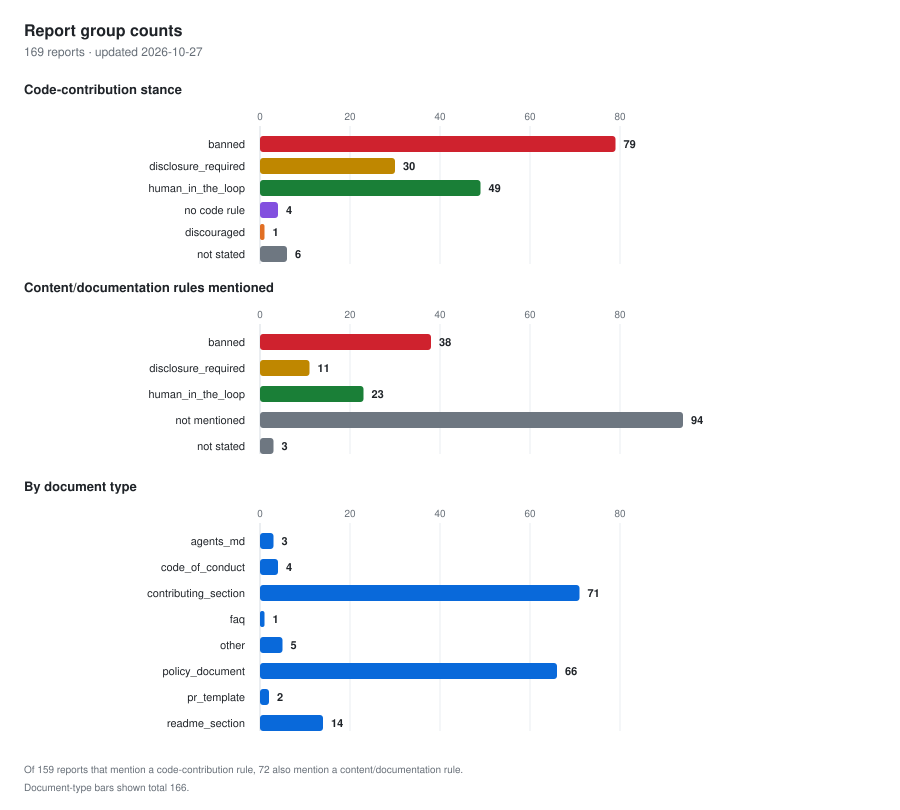

# AI policy coverage: 169 projects

Part of the [project cohorts index](../README.md).

These reports use the [CHAOSS policy specificity metric](https://github.com/chaoss/wg-ai-alignment/blob/main/metrics/ai-alignment-community-governed-use/ai-use-consent-policy-specificity.md#taxonomy-of-domains). They were scored before slop was added, so they cover nine topics and have not been rescored. The [critical dependencies](../critical-dependencies/README.md) reports cover all ten.

`X` = supervision plus another detail; `~` = limited detail or general guidance; `R` = reason for a rule, not a rule; blank = none found in the document reviewed. `discouraged` means advised against, not banned. The scoring cutoffs are our interpretation.

| Project | Code contributions | Notetaker and meeting bots | Content and documentation | Moderation and enforcement | Review of contributions | Autonomous and agentic use | Environmental impact | Infrastructure strain | Data use for training |
| --- | :-: | :-: | :-: | :-: | :-: | :-: | :-: | :-: | :-: |
| [afnix](afnix/2026-08-30.md) | ~ |  |  |  |  |  |  |  |  |
| [Alacritty](alacritty/2026-10-21.md) | X |  | ~ |  |  |  |  |  |  |
| [Allium](allium/2026-10-21.md) | X |  |  | ~ |  |  |  |  |  |
| [Amberol](amberol/2026-10-21.md) | X |  | X |  |  |  |  |  |  |
| [apache](apache/2026-08-30.md) | X |  | X |  |  | ~ |  |  |  |
| [Apache Airflow](apache-airflow/2026-10-21.md) | X |  |  | X |  |  |  |  |  |
| [Apache CouchDB](apache-couchdb/2026-10-21.md) | X |  | ~ |  |  |  |  |  |  |
| [Apache DataFusion](apache-datafusion/2026-10-21.md) | X |  |  |  |  | R |  |  |  |
| [Apache Kvrocks](apache-kvrocks/2026-10-21.md) | X |  | ~ | ~ |  | ~ |  |  |  |
| [Apache PouchDB](apache-pouchdb/2026-10-21.md) | X |  | ~ |  |  |  |  |  |  |
| [Arcalibre](arcalibre/2026-10-21.md) | ~ |  |  |  |  |  | R |  | R |
| [Arrow](arrow/2026-10-21.md) | X |  |  | ~ | X | X |  |  |  |
| [Asahi Linux](asahi-linux/2026-10-21.md) | X |  |  | ~ |  | R | R |  |  |
| [astropy/astropy-project](astropy-astropy-project/2026-08-30.md) | X |  | ~ |  |  | X |  |  |  |
| [Avoyd](avoyd/2026-10-21.md) |  |  |  |  |  |  |  |  |  |
| [Bevy](bevy/2026-10-21.md) | X |  | X | X | ~ | ~ |  |  |  |
| [Bobby](bobby/2026-10-21.md) | X |  | ~ |  |  |  |  |  |  |
| [borgmatic](borgmatic/2026-10-21.md) | X |  |  |  |  | X |  |  |  |
| [CapyPDF](capypdf/2026-10-21.md) | X |  |  | ~ |  |  |  |  |  |
| [castle-game-engine](castle-game-engine/2026-08-30.md) | X |  | ~ |  | X | X |  |  |  |
| [Cataclysm: Dark Days Ahead](cataclysm-dark-days-ahead/2026-10-21.md) | X |  |  |  |  |  |  |  |  |
| [CC Open Source](cc-open-source/2026-10-21.md) | X |  | ~ |  |  |  |  |  |  |
| [CCExtractor](ccextractor/2026-10-21.md) | X |  |  | ~ | X | ~ |  |  |  |
| [Cheese Paper](cheese-paper/2026-10-21.md) | X |  |  |  |  |  |  |  |  |
| [chezmoi](chezmoi/2026-10-21.md) | X |  |  | ~ |  |  |  |  |  |
| [Chimera Linux](chimera-linux/2026-10-21.md) | ~ |  |  |  |  |  |  |  |  |
| [ChiPass](chipass/2026-10-21.md) | ~ |  |  |  |  |  |  |  |  |
| [cilium](cilium/2026-10-21.md) | X |  | X | ~ | ~ |  |  |  |  |
| [Clojure](clojure/2026-10-21.md) | X |  |  |  | ~ |  |  |  |  |
| [CloudNativePG](cloudnativepg/2026-10-21.md) | X |  | ~ | ~ |  | ~ |  |  |  |
| [codeberg](codeberg/2026-08-31.md) |  |  |  | ~ |  | R | R | R | R |
| [conda](conda/2026-10-21.md) | X |  |  | ~ | X | X |  |  |  |
| [CPython](cpython/2026-10-21.md) | X |  | ~ | ~ |  |  |  |  |  |
| [CuPy](cupy/2026-10-21.md) | X |  |  | ~ |  |  |  |  |  |
| [curl](curl/2026-10-21.md) | X |  | ~ | ~ |  |  |  |  |  |
| [DataJourneyHQ](datajourneyhq/2026-10-21.md) | X |  |  |  | R |  |  |  |  |
| [debian](debian/2026-08-30.md) | ~ |  | ~ | ~ | R | X | R | R |  |
| [Decker](decker/2026-10-21.md) | X |  |  |  |  |  |  |  |  |
| [Django](django/2026-10-21.md) | X |  | ~ | ~ | X | X |  |  |  |
| [dlt](dlt/2026-10-21.md) | X |  |  | ~ |  | X |  |  |  |
| [do](do/2026-10-21.md) | X |  |  | ~ |  |  |  |  |  |
| [Drupal](drupal/2026-10-21.md) | X |  | ~ | X | ~ | R |  |  |  |
| [Dune 3D](dune-3d/2026-10-21.md) | X |  |  |  |  |  |  |  |  |
| [EasyBuild](easybuild/2026-10-21.md) | X | ~ | X |  | X |  |  |  |  |
| [Elastic](elastic/2026-10-21.md) | X |  | X |  |  |  |  |  |  |
| [Elementary OS](elementary-os/2026-10-21.md) | X |  | X |  |  |  | R |  |  |
| [EmulatorKit](emulatorkit/2026-10-21.md) | ~ |  |  |  |  |  |  |  |  |
| [Endless Sky](endless-sky/2026-10-21.md) | X |  | ~ |  |  |  |  |  |  |
| [Evi](evi/2026-10-21.md) | X |  |  | ~ |  |  |  |  |  |
| [Exim](exim/2026-10-21.md) | ~ |  |  |  |  |  |  |  |  |
| [FastAPI](fastapi/2026-10-21.md) | X |  |  | ~ |  | ~ |  |  |  |
| [Fedify](fedify/2026-10-21.md) | X |  | X | ~ |  |  |  |  |  |
| [Fedora](fedora/2026-10-21.md) | X |  | X | X | X | ~ |  | ~ |  |
| [Fennel](fennel/2026-10-21.md) | X |  |  | ~ |  |  |  |  | X |
| [Firefox](firefox/2026-10-21.md) | X |  |  |  | X |  |  |  |  |
| [Flutter](flutter/2026-10-21.md) | ~ |  |  |  |  |  |  |  |  |
| [forgejo](forgejo/2026-08-30.md) | X |  | X |  | ~ | X |  |  |  |
| [Fractal](fractal/2026-10-21.md) | X |  | X |  |  |  | R |  | R |
| [gaypanel](gaypanel/2026-10-21.md) | ~ |  |  |  |  |  |  |  |  |
| [gcc](gcc/2026-08-30.md) | X |  |  |  | ~ | ~ |  |  |  |
| [gdal-site](gdal-site/2026-08-30.md) | X |  |  |  | R | ~ |  |  |  |
| [Gedit](gedit/2026-10-21.md) | X |  | ~ |  |  |  |  |  |  |
| [gentoo](gentoo/2026-08-30.md) | ~ |  |  |  |  |  | R |  |  |
| [ghostty-org/ghostty](ghostty-org-ghostty/2026-08-30.md) | ~ |  | ~ | ~ |  |  |  |  |  |
| [GIMP](gimp/2026-10-21.md) | X |  | ~ |  |  |  |  |  |  |
| [Gitte](gitte/2026-10-21.md) | X |  |  |  |  |  |  |  |  |
| [Glasgow Interface Explorer](glasgow-interface-explorer/2026-10-21.md) | X |  |  |  |  |  |  |  |  |
| [GNOME Extensions](gnome-extensions/2026-10-21.md) | X |  |  | ~ |  |  |  |  |  |
| [GNOME Loupe](gnome-loupe/2026-10-21.md) | X |  | X |  |  |  |  |  |  |
| [go-gitea/gitea](go-gitea-gitea/2026-08-30.md) | X |  |  | ~ |  |  |  |  |  |
| [godot](godot/2026-08-31.md) | X |  | ~ | ~ | ~ | ~ |  |  |  |
| [goose](goose/2026-10-21.md) | X |  |  | ~ | X | ~ |  |  |  |
| [GoToSocial](gotosocial/2026-10-21.md) | X |  | ~ |  |  |  |  |  |  |
| [Gram](gram/2026-10-21.md) | X |  | ~ | X |  |  |  |  |  |
| [Halloy](halloy/2026-10-21.md) | X |  | ~ |  |  |  |  |  |  |
| [Highscore](highscore/2026-10-21.md) | X |  | X |  |  |  |  |  |  |
| [Homebrew](homebrew/2026-10-21.md) | X |  |  |  | ~ |  |  |  |  |
| [Icechunk](icechunk/2026-10-21.md) | X |  | X | ~ | ~ | X |  |  |  |
| [Idris](idris/2026-10-21.md) | X |  |  |  |  | X |  |  |  |
| [Inkscape](inkscape/2026-10-21.md) |  |  |  |  |  |  |  |  |  |
| [Inochi2D](inochi2d/2026-10-21.md) | X |  | ~ | ~ |  |  |  |  |  |
| [IREE (Intermediate Representation Execution Environment)](iree/2026-10-21.md) | X |  | ~ |  |  | X |  |  |  |
| [jazzband/pip-tools](jazzband-pip-tools/2026-08-30.md) | X |  |  | ~ |  | ~ |  |  |  |
| [jellyfin/jellyfin.org](jellyfin-jellyfin-org/2026-08-30.md) | X |  |  | ~ |  | X |  |  |  |
| [Joomla](joomla/2026-10-21.md) | X |  | ~ | ~ |  |  |  |  |  |
| [Jqwik](jqwik/2026-10-21.md) | X |  |  |  |  |  |  |  |  |
| [jsoup](jsoup/2026-10-21.md) | X |  |  |  |  |  |  |  |  |
| [kde-gsoc](kde-gsoc/2026-08-30.md) | ~ |  |  |  |  |  | R |  |  |
| [keepassxreboot/keepassxc](keepassxreboot-keepassxc/2026-08-30.md) | ~ |  |  |  |  |  |  |  |  |
| [Kornia](kornia/2026-10-21.md) | ~ |  |  |  |  |  |  |  |  |
| [Kubernetes](kubernetes/2026-10-21.md) | X |  | ~ | ~ | ~ |  |  |  |  |
| [Leiningen](leiningen/2026-10-21.md) | ~ |  |  |  |  |  |  |  |  |
| [libadwaita](libadwaita/2026-10-21.md) | X |  | X |  |  |  |  |  |  |
| [libmanette](libmanette/2026-10-21.md) | X |  | X |  |  |  |  |  |  |
| [libxml2](libxml2/2026-10-21.md) | X |  |  |  |  |  |  |  |  |
| [Lighthouse](lighthouse/2026-10-21.md) | X |  |  | ~ |  | ~ |  |  |  |
| [LinkML](linkml/2026-10-21.md) | X |  | ~ |  | X | X |  |  |  |
| [linux-foundation](linux-foundation/2026-08-30.md) | X |  | ~ |  | R |  |  |  | R |
| [llvm/llvm-project](llvm-llvm-project/2026-08-30.md) | X |  | X | ~ | ~ | ~ |  |  |  |
| [Lobsters](lobsters/2026-10-21.md) | X |  |  |  |  |  |  |  |  |
| [LÖVE](love2d/2026-10-21.md) | X |  |  |  |  |  |  |  |  |
| [mastodon/.github](mastodon-github/2026-08-30.md) | X |  | ~ |  | X | X |  |  |  |
| [matplotlib/matplotlib](matplotlib-matplotlib/2026-08-30.md) | X |  |  | ~ |  | ~ |  |  |  |
| [MDAnalysis](mdanalysis/2026-10-21.md) | X |  | X | ~ | X | X |  |  |  |
| [Mesa](mesa/2026-10-21.md) | X |  |  |  | X | X |  |  |  |
| [mGBA](mgba/2026-10-21.md) | X |  |  | ~ |  |  |  |  |  |
| [MicroPython](micropython/2026-10-21.md) | X |  |  | ~ |  | X |  |  |  |
| [Mikan](mikan/2026-10-21.md) | X |  |  |  |  |  |  |  |  |
| [Molecular Nodes](molecular-nodes/2026-10-21.md) | X |  | X | X | X | X |  |  |  |
| [napari](napari/2026-10-21.md) | X |  |  | ~ |  | X |  |  |  |
| [NetBSD](netbsd/2026-10-21.md) | X |  |  |  |  |  |  |  |  |
| [nlnet-labs](nlnet-labs/2026-08-30.md) | X |  | ~ |  | X |  |  |  |  |
| [NumPy](numpy/2026-10-21.md) | X |  |  | ~ |  | X |  |  |  |
| [nvim-tree](nvim-tree/2026-10-21.md) | X |  | ~ | ~ | X | ~ |  |  |  |
| [OCaml](ocaml/2026-10-21.md) | X |  |  |  | ~ |  |  |  |  |
| [OkHttp](okhttp/2026-10-21.md) | X |  | ~ | ~ |  |  |  |  |  |
| [Open edX](open-edx/2026-10-21.md) | X |  | ~ | ~ | X | ~ |  |  |  |
| [openinfra](openinfra/2026-08-30.md) | X |  | ~ |  |  | ~ |  |  |  |
| [OpenJDK](openjdk/2026-10-21.md) | X |  | X | ~ | X |  |  |  |  |
| [OpenTTD](openttd/2026-10-21.md) | X |  |  | ~ |  | ~ |  |  |  |
| [OSGeo/gdal](osgeo-gdal/2026-08-30.md) | X |  |  | ~ | R | X |  | R |  |
| [OSGeo/PROJ](osgeo-proj/2026-08-30.md) | X |  | ~ | ~ | ~ | ~ |  |  |  |
| [oxide](oxide/2026-08-30.md) | X |  | X |  | ~ |  |  |  | ~ |
| [Pallets](pallets/2026-10-21.md) | X |  | ~ | ~ | ~ |  | R |  |  |
| [Pandas](pandas/2026-10-21.md) | X |  | ~ | ~ | ~ |  |  |  |  |
| [Pandemonium Engine](pandemonium-engine/2026-10-21.md) | X |  | X |  |  |  | R |  |  |
| [pgwatch](pgwatch/2026-10-21.md) | X |  |  | ~ | ~ |  |  |  |  |
| [pip](pip/2026-10-21.md) | X |  |  | ~ |  | X |  |  |  |
| [pkgconf](pkgconf/2026-10-21.md) | X |  |  | ~ |  | X |  |  |  |
| [Poezio](poezio/2026-10-21.md) | X |  | ~ |  |  |  |  |  |  |
| [pola-rs/polars](pola-rs-polars/2026-08-30.md) | ~ |  | ~ |  | ~ | ~ |  |  |  |
| [Polyphony](polyphony/2026-10-21.md) | X |  | X | X |  |  | R |  | R |
| [postmarketos](postmarketos/2026-08-30.md) | ~ |  |  |  |  |  | R | R |  |
| [Processing/p5.js](processing-p5-js/2026-10-21.md) | X |  | ~ | ~ | X | X | R |  |  |
| [Pytest](pytest/2026-10-21.md) | X |  |  | ~ |  | X |  |  |  |
| [python-attrs/attrs](python-attrs-attrs/2026-08-30.md) | ~ |  |  |  |  |  |  |  |  |
| [PyTorch](pytorch/2026-10-21.md) |  |  |  | ~ | ~ |  |  |  |  |
| [PyVista](pyvista/2026-10-21.md) | X |  | ~ |  |  | ~ |  | ~ |  |
| [qemu/qemu](qemu-qemu/2026-08-30.md) | X |  |  |  |  |  |  |  |  |
| [qgis/QGIS-Enhancement-Proposals](qgis-qgis-enhancement-proposals/2026-08-30.md) | X |  | X | ~ | ~ | ~ |  | R |  |
| [qutip](qutip/2026-10-21.md) | X |  | ~ | ~ | X | X |  |  |  |
| [Redox OS](redox-os/2026-10-21.md) | X |  |  | ~ |  |  |  |  |  |
| [Requests](requests/2026-10-21.md) | X |  |  | ~ | X | X |  |  |  |
| [rust](rust/2026-08-31.md) | X |  | X | ~ | X | ~ | R |  |  |
| [Schism Tracker](schism-tracker/2026-10-21.md) | X |  |  |  | ~ |  |  |  |  |
| [SciActive](sciactive/2026-10-21.md) | X |  | X | ~ |  | X |  |  | R |
| [scikit-image](scikit-image/2026-10-21.md) | X |  |  |  |  |  |  |  |  |
| [scikit-learn/scikit-learn](scikit-learn-scikit-learn/2026-08-30.md) | ~ |  |  | ~ | ~ |  |  |  |  |
| [SciPy](scipy/2026-10-21.md) | X |  |  | ~ |  | X |  |  |  |
| [SDL](sdl/2026-10-21.md) | X |  |  |  |  |  |  |  |  |
| [SDL_net](sdl-net/2026-10-21.md) | X |  |  |  |  |  |  |  |  |
| [SearXNG](searxng/2026-10-21.md) | X |  | ~ | ~ |  |  |  |  |  |
| [Sentinel](sentinel/2026-10-21.md) | X |  |  | X |  |  |  |  |  |
| [servo/book](servo-book/2026-08-30.md) | X |  | ~ | ~ | ~ |  | R |  |  |
| [Smederee](smederee/2026-10-21.md) | X |  |  |  |  |  |  |  |  |
| [snac](snac/2026-10-21.md) | X |  |  |  |  |  |  |  |  |
| [Sphinx](sphinx/2026-10-21.md) | X |  |  | ~ |  | X |  |  |  |
| [STAC](stac/2026-10-21.md) | X |  | X | X | X | X |  |  |  |
| [stb](stb/2026-10-21.md) | X |  | ~ |  |  |  |  |  |  |
| [sunpy/sunpy](sunpy-sunpy/2026-08-30.md) | ~ |  | ~ |  |  |  |  |  |  |
| [SymPy](sympy/2026-10-21.md) | X |  |  | ~ |  |  |  |  |  |
| [teamtype/teamtype](teamtype-teamtype/2026-08-30.md) | ~ |  | ~ |  |  |  |  |  |  |
| [Telegraf](telegraf/2026-10-21.md) | X |  |  |  |  |  |  |  |  |
| [Tenacity](tenacity/2026-10-21.md) | X |  |  | ~ |  |  |  | R |  |
| [TorchGeo](torchgeo/2026-10-21.md) | X |  | ~ | ~ |  | X |  |  |  |
| [torvalds/linux](torvalds-linux/2026-08-30.md) | X |  |  |  |  | X |  |  |  |
| [Tusky](tusky/2026-10-21.md) | X |  |  |  |  |  |  |  |  |
| [yt-dlp/yt-dlp](yt-dlp-yt-dlp/2026-08-30.md) | ~ |  |  |  | ~ | ~ |  |  |  |
| [zulip/zulip](zulip-zulip/2026-08-30.md) | X |  |  |  |  |  |  |  |  |

## Charts

See the [79 code-contribution reports classified as banned](CODE-CONTRIBUTION-BANS.md) for source wording and scope. This is not a count of blanket bans.

### Policy changes over time

## Included in Policy

Counts include `X` and `~`; `R` and blank entries are excluded.

| Topic | Projects with `X` or `~` |
|---|---:|
| Code contributions | 165 |
| Notetaker and meeting bots | 1 |
| Content and documentation | 75 |
| Moderation and enforcement | 79 |
| Review of contributions | 47 |
| Autonomous and agentic use | 59 |
| Environmental impact | 0 |
| Infrastructure strain | 2 |
| Data use for training | 2 |

## Included in Rationale

These charts count topics cited as reasons for policies; they do not show whether a separate rule exists.

