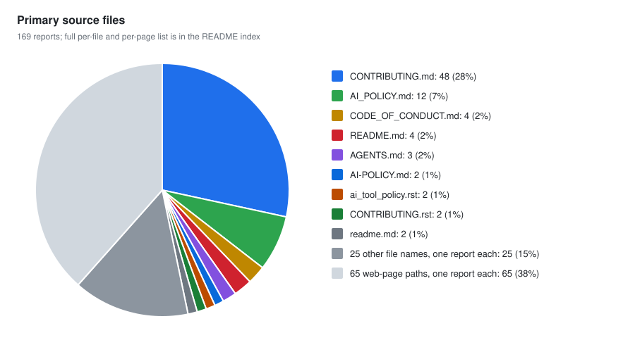
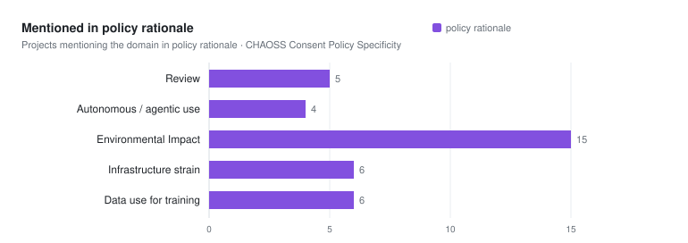

# AI policy coverage: 169 projects

Part of the [project cohorts index](../README.md).

These reports use the [CHAOSS policy specificity metric](https://github.com/chaoss/wg-ai-alignment/blob/main/metrics/ai-alignment-community-governed-use/ai-use-consent-policy-specificity.md#taxonomy-of-domains). They were scored before slop was added, so they cover nine topics and have not been rescored. The [critical dependencies](../critical-dependencies/README.md) reports cover all ten.

`X` = supervision plus another detail; `~` = limited detail or general guidance; `R` = reason for a rule, not a rule; blank = none found in the document reviewed. `discouraged` means advised against, not banned. The scoring cutoffs are our interpretation.

| Project | Code contributions | Notetaker and meeting bots | Content and documentation | Moderation and enforcement | Review of contributions | Autonomous and agentic use | Environmental impact | Infrastructure strain | Data use for training |
| --- | :-: | :-: | :-: | :-: | :-: | :-: | :-: | :-: | :-: |
| [afnix](afnix/2026-08-30.md) | ~ |  |  |  |  |  |  |  |  |
| [Alacritty](alacritty/2026-10-21.md) | X |  | ~ |  |  |  |  |  |  |
| [Allium](allium/2026-10-21.md) | X |  |  | ~ |  |  |  |  |  |
| [Amberol](amberol/2026-10-21.md) | X |  | X |  |  |  |  |  |  |
| [apache](apache/2026-08-30.md) | X |  | X |  |  | ~ |  |  |  |
| [Apache Airflow](apache-airflow/2026-10-21.md) | X |  |  | X |  |  |  |  |  |
| [Apache CouchDB](apache-couchdb/2026-10-21.md) | X |  | ~ |  |  |  |  |  |  |
| [Apache DataFusion](apache-datafusion/2026-10-21.md) | X |  |  |  |  | R |  |  |  |
| [Apache Kvrocks](apache-kvrocks/2026-10-21.md) | X |  | ~ | ~ |  | ~ |  |  |  |
| [Apache PouchDB](apache-pouchdb/2026-10-21.md) | X |  | ~ |  |  |  |  |  |  |
| [Arcalibre](arcalibre/2026-10-21.md) | ~ |  |  |  |  |  | R |  | R |
| [Arrow](arrow/2026-10-21.md) | X |  |  | ~ | X | X |  |  |  |
| [Asahi Linux](asahi-linux/2026-10-21.md) | X |  |  | ~ |  | R | R |  |  |
| [astropy/astropy-project](astropy-astropy-project/2026-08-30.md) | X |  | ~ |  |  | X |  |  |  |
| [Avoyd](avoyd/2026-10-21.md) |  |  |  |  |  |  |  |  |  |
| [Bevy](bevy/2026-10-21.md) | X |  | X | X | ~ | ~ |  |  |  |
| [Bobby](bobby/2026-10-21.md) | X |  | ~ |  |  |  |  |  |  |
| [borgmatic](borgmatic/2026-10-21.md) | X |  |  |  |  | X |  |  |  |
| [CapyPDF](capypdf/2026-10-21.md) | X |  |  | ~ |  |  |  |  |  |
| [castle-game-engine](castle-game-engine/2026-08-30.md) | X |  | ~ |  | X | X |  |  |  |
| [Cataclysm: Dark Days Ahead](cataclysm-dark-days-ahead/2026-10-21.md) | X |  |  |  |  |  |  |  |  |
| [CC Open Source](cc-open-source/2026-10-21.md) | X |  | ~ |  |  |  |  |  |  |
| [CCExtractor](ccextractor/2026-10-21.md) | X |  |  | ~ | X | ~ |  |  |  |
| [Cheese Paper](cheese-paper/2026-10-21.md) | X |  |  |  |  |  |  |  |  |
| [chezmoi](chezmoi/2026-10-21.md) | X |  |  | ~ |  |  |  |  |  |
| [Chimera Linux](chimera-linux/2026-10-21.md) | ~ |  |  |  |  |  |  |  |  |
| [ChiPass](chipass/2026-10-21.md) | ~ |  |  |  |  |  |  |  |  |
| [cilium](cilium/2026-10-21.md) | X |  | X | ~ | ~ |  |  |  |  |
| [Clojure](clojure/2026-10-21.md) | X |  |  |  | ~ |  |  |  |  |
| [CloudNativePG](cloudnativepg/2026-10-21.md) | X |  | ~ | ~ |  | ~ |  |  |  |
| [codeberg](codeberg/2026-08-31.md) |  |  |  | ~ |  | R | R | R | R |
| [conda](conda/2026-10-21.md) | X |  |  | ~ | X | X |  |  |  |
| [CPython](cpython/2026-10-21.md) | X |  | ~ | ~ |  |  |  |  |  |
| [CuPy](cupy/2026-10-21.md) | X |  |  | ~ |  |  |  |  |  |
| [curl](curl/2026-10-21.md) | X |  | ~ | ~ |  |  |  |  |  |
| [DataJourneyHQ](datajourneyhq/2026-10-21.md) | X |  |  |  | R |  |  |  |  |
| [debian](debian/2026-08-30.md) | ~ |  | ~ | ~ | R | X | R | R |  |
| [Decker](decker/2026-10-21.md) | X |  |  |  |  |  |  |  |  |
| [Django](django/2026-10-21.md) | X |  | ~ | ~ | X | X |  |  |  |
| [dlt](dlt/2026-10-21.md) | X |  |  | ~ |  | X |  |  |  |
| [do](do/2026-10-21.md) | X |  |  | ~ |  |  |  |  |  |
| [Drupal](drupal/2026-10-21.md) | X |  | ~ | X | ~ | R |  |  |  |
| [Dune 3D](dune-3d/2026-10-21.md) | X |  |  |  |  |  |  |  |  |
| [EasyBuild](easybuild/2026-10-21.md) | X | ~ | X |  | X |  |  |  |  |
| [Elastic](elastic/2026-10-21.md) | X |  | X |  |  |  |  |  |  |
| [Elementary OS](elementary-os/2026-10-21.md) | X |  | X |  |  |  | R |  |  |
| [EmulatorKit](emulatorkit/2026-10-21.md) | ~ |  |  |  |  |  |  |  |  |
| [Endless Sky](endless-sky/2026-10-21.md) | X |  | ~ |  |  |  |  |  |  |
| [Evi](evi/2026-10-21.md) | X |  |  | ~ |  |  |  |  |  |
| [Exim](exim/2026-10-21.md) | ~ |  |  |  |  |  |  |  |  |
| [FastAPI](fastapi/2026-10-21.md) | X |  |  | ~ |  | ~ |  |  |  |
| [Fedify](fedify/2026-10-21.md) | X |  | X | ~ |  |  |  |  |  |
| [Fedora](fedora/2026-10-21.md) | X |  | X | X | X | ~ |  | ~ |  |
| [Fennel](fennel/2026-10-21.md) | X |  |  | ~ |  |  |  |  | X |
| [Firefox](firefox/2026-10-21.md) | X |  |  |  | X |  |  |  |  |
| [Flutter](flutter/2026-10-21.md) | ~ |  |  |  |  |  |  |  |  |
| [forgejo](forgejo/2026-08-30.md) | X |  | X |  | ~ | X |  |  |  |
| [Fractal](fractal/2026-10-21.md) | X |  | X |  |  |  | R |  | R |
| [gaypanel](gaypanel/2026-10-21.md) | ~ |  |  |  |  |  |  |  |  |
| [gcc](gcc/2026-08-30.md) | X |  |  |  | ~ | ~ |  |  |  |
| [gdal-site](gdal-site/2026-08-30.md) | X |  |  |  | R | ~ |  |  |  |
| [Gedit](gedit/2026-10-21.md) | X |  | ~ |  |  |  |  |  |  |
| [gentoo](gentoo/2026-08-30.md) | ~ |  |  |  |  |  | R |  |  |
| [ghostty-org/ghostty](ghostty-org-ghostty/2026-08-30.md) | ~ |  | ~ | ~ |  |  |  |  |  |
| [GIMP](gimp/2026-10-21.md) | X |  | ~ |  |  |  |  |  |  |
| [Gitte](gitte/2026-10-21.md) | X |  |  |  |  |  |  |  |  |
| [Glasgow Interface Explorer](glasgow-interface-explorer/2026-10-21.md) | X |  |  |  |  |  |  |  |  |
| [GNOME Extensions](gnome-extensions/2026-10-21.md) | X |  |  | ~ |  |  |  |  |  |
| [GNOME Loupe](gnome-loupe/2026-10-21.md) | X |  | X |  |  |  |  |  |  |
| [go-gitea/gitea](go-gitea-gitea/2026-08-30.md) | X |  |  | ~ |  |  |  |  |  |
| [godot](godot/2026-08-31.md) | X |  | ~ | ~ | ~ | ~ |  |  |  |
| [goose](goose/2026-10-21.md) | X |  |  | ~ | X | ~ |  |  |  |
| [GoToSocial](gotosocial/2026-10-21.md) | X |  | ~ |  |  |  |  |  |  |
| [Gram](gram/2026-10-21.md) | X |  | ~ | X |  |  |  |  |  |
| [Halloy](halloy/2026-10-21.md) | X |  | ~ |  |  |  |  |  |  |
| [Highscore](highscore/2026-10-21.md) | X |  | X |  |  |  |  |  |  |
| [Homebrew](homebrew/2026-10-21.md) | X |  |  |  | ~ |  |  |  |  |
| [Icechunk](icechunk/2026-10-21.md) | X |  | X | ~ | ~ | X |  |  |  |
| [Idris](idris/2026-10-21.md) | X |  |  |  |  | X |  |  |  |
| [Inkscape](inkscape/2026-10-21.md) |  |  |  |  |  |  |  |  |  |
| [Inochi2D](inochi2d/2026-10-21.md) | X |  | ~ | ~ |  |  |  |  |  |
| [IREE (Intermediate Representation Execution Environment)](iree/2026-10-21.md) | X |  | ~ |  |  | X |  |  |  |
| [jazzband/pip-tools](jazzband-pip-tools/2026-08-30.md) | X |  |  | ~ |  | ~ |  |  |  |
| [jellyfin/jellyfin.org](jellyfin-jellyfin-org/2026-08-30.md) | X |  |  | ~ |  | X |  |  |  |
| [Joomla](joomla/2026-10-21.md) | X |  | ~ | ~ |  |  |  |  |  |
| [Jqwik](jqwik/2026-10-21.md) | X |  |  |  |  |  |  |  |  |
| [jsoup](jsoup/2026-10-21.md) | X |  |  |  |  |  |  |  |  |
| [kde-gsoc](kde-gsoc/2026-08-30.md) | ~ |  |  |  |  |  | R |  |  |
| [keepassxreboot/keepassxc](keepassxreboot-keepassxc/2026-08-30.md) | ~ |  |  |  |  |  |  |  |  |
| [Kornia](kornia/2026-10-21.md) | ~ |  |  |  |  |  |  |  |  |
| [Kubernetes](kubernetes/2026-10-21.md) | X |  | ~ | ~ | ~ |  |  |  |  |
| [Leiningen](leiningen/2026-10-21.md) | ~ |  |  |  |  |  |  |  |  |
| [libadwaita](libadwaita/2026-10-21.md) | X |  | X |  |  |  |  |  |  |
| [libmanette](libmanette/2026-10-21.md) | X |  | X |  |  |  |  |  |  |
| [libxml2](libxml2/2026-10-21.md) | X |  |  |  |  |  |  |  |  |
| [Lighthouse](lighthouse/2026-10-21.md) | X |  |  | ~ |  | ~ |  |  |  |
| [LinkML](linkml/2026-10-21.md) | X |  | ~ |  | X | X |  |  |  |
| [linux-foundation](linux-foundation/2026-08-30.md) | X |  | ~ |  | R |  |  |  | R |
| [llvm/llvm-project](llvm-llvm-project/2026-08-30.md) | X |  | X | ~ | ~ | ~ |  |  |  |
| [Lobsters](lobsters/2026-10-21.md) | X |  |  |  |  |  |  |  |  |
| [LÖVE](love2d/2026-10-21.md) | X |  |  |  |  |  |  |  |  |
| [mastodon/.github](mastodon-github/2026-08-30.md) | X |  | ~ |  | X | X |  |  |  |
| [matplotlib/matplotlib](matplotlib-matplotlib/2026-08-30.md) | X |  |  | ~ |  | ~ |  |  |  |
| [MDAnalysis](mdanalysis/2026-10-21.md) | X |  | X | ~ | X | X |  |  |  |
| [Mesa](mesa/2026-10-21.md) | X |  |  |  | X | X |  |  |  |
| [mGBA](mgba/2026-10-21.md) | X |  |  | ~ |  |  |  |  |  |
| [MicroPython](micropython/2026-10-21.md) | X |  |  | ~ |  | X |  |  |  |
| [Mikan](mikan/2026-10-21.md) | X |  |  |  |  |  |  |  |  |
| [Molecular Nodes](molecular-nodes/2026-10-21.md) | X |  | X | X | X | X |  |  |  |
| [napari](napari/2026-10-21.md) | X |  |  | ~ |  | X |  |  |  |
| [NetBSD](netbsd/2026-10-21.md) | X |  |  |  |  |  |  |  |  |
| [nlnet-labs](nlnet-labs/2026-08-30.md) | X |  | ~ |  | X |  |  |  |  |
| [NumPy](numpy/2026-10-21.md) | X |  |  | ~ |  | X |  |  |  |
| [nvim-tree](nvim-tree/2026-10-21.md) | X |  | ~ | ~ | X | ~ |  |  |  |
| [OCaml](ocaml/2026-10-21.md) | X |  |  |  | ~ |  |  |  |  |
| [OkHttp](okhttp/2026-10-21.md) | X |  | ~ | ~ |  |  |  |  |  |
| [Open edX](open-edx/2026-10-21.md) | X |  | ~ | ~ | X | ~ |  |  |  |
| [openinfra](openinfra/2026-08-30.md) | X |  | ~ |  |  | ~ |  |  |  |
| [OpenJDK](openjdk/2026-10-21.md) | X |  | X | ~ | X |  |  |  |  |
| [OpenTTD](openttd/2026-10-21.md) | X |  |  | ~ |  | ~ |  |  |  |
| [OSGeo/gdal](osgeo-gdal/2026-08-30.md) | X |  |  | ~ | R | X |  | R |  |
| [OSGeo/PROJ](osgeo-proj/2026-08-30.md) | X |  | ~ | ~ | ~ | ~ |  |  |  |
| [oxide](oxide/2026-08-30.md) | X |  | X |  | ~ |  |  |  | ~ |
| [Pallets](pallets/2026-10-21.md) | X |  | ~ | ~ | ~ |  | R |  |  |
| [Pandas](pandas/2026-10-21.md) | X |  | ~ | ~ | ~ |  |  |  |  |
| [Pandemonium Engine](pandemonium-engine/2026-10-21.md) | X |  | X |  |  |  | R |  |  |
| [pgwatch](pgwatch/2026-10-21.md) | X |  |  | ~ | ~ |  |  |  |  |
| [pip](pip/2026-10-21.md) | X |  |  | ~ |  | X |  |  |  |
| [pkgconf](pkgconf/2026-10-21.md) | X |  |  | ~ |  | X |  |  |  |
| [Poezio](poezio/2026-10-21.md) | X |  | ~ |  |  |  |  |  |  |
| [pola-rs/polars](pola-rs-polars/2026-08-30.md) | ~ |  | ~ |  | ~ | ~ |  |  |  |
| [Polyphony](polyphony/2026-10-21.md) | X |  | X | X |  |  | R |  | R |
| [postmarketos](postmarketos/2026-08-30.md) | ~ |  |  |  |  |  | R | R |  |
| [Processing/p5.js](processing-p5-js/2026-10-21.md) | X |  | ~ | ~ | X | X | R |  |  |
| [Pytest](pytest/2026-10-21.md) | X |  |  | ~ |  | X |  |  |  |
| [python-attrs/attrs](python-attrs-attrs/2026-08-30.md) | ~ |  |  |  |  |  |  |  |  |
| [PyTorch](pytorch/2026-10-21.md) |  |  |  | ~ | ~ |  |  |  |  |
| [PyVista](pyvista/2026-10-21.md) | X |  | ~ |  |  | ~ |  | ~ |  |
| [qemu/qemu](qemu-qemu/2026-08-30.md) | X |  |  |  |  |  |  |  |  |
| [qgis/QGIS-Enhancement-Proposals](qgis-qgis-enhancement-proposals/2026-08-30.md) | X |  | X | ~ | ~ | ~ |  | R |  |
| [qutip](qutip/2026-10-21.md) | X |  | ~ | ~ | X | X |  |  |  |
| [Redox OS](redox-os/2026-10-21.md) | X |  |  | ~ |  |  |  |  |  |
| [Requests](requests/2026-10-21.md) | X |  |  | ~ | X | X |  |  |  |
| [rust](rust/2026-08-31.md) | X |  | X | ~ | X | ~ | R |  |  |
| [Schism Tracker](schism-tracker/2026-10-21.md) | X |  |  |  | ~ |  |  |  |  |
| [SciActive](sciactive/2026-10-21.md) | X |  | X | ~ |  | X |  |  | R |
| [scikit-image](scikit-image/2026-10-21.md) | X |  |  |  |  |  |  |  |  |
| [scikit-learn/scikit-learn](scikit-learn-scikit-learn/2026-08-30.md) | ~ |  |  | ~ | ~ |  |  |  |  |
| [SciPy](scipy/2026-10-21.md) | X |  |  | ~ |  | X |  |  |  |
| [SDL](sdl/2026-10-21.md) | X |  |  |  |  |  |  |  |  |
| [SDL_net](sdl-net/2026-10-21.md) | X |  |  |  |  |  |  |  |  |
| [SearXNG](searxng/2026-10-21.md) | X |  | ~ | ~ |  |  |  |  |  |
| [Sentinel](sentinel/2026-10-21.md) | X |  |  | X |  |  |  |  |  |
| [servo/book](servo-book/2026-08-30.md) | X |  | ~ | ~ | ~ |  | R |  |  |
| [Smederee](smederee/2026-10-21.md) | X |  |  |  |  |  |  |  |  |
| [snac](snac/2026-10-21.md) | X |  |  |  |  |  |  |  |  |
| [Sphinx](sphinx/2026-10-21.md) | X |  |  | ~ |  | X |  |  |  |
| [STAC](stac/2026-10-21.md) | X |  | X | X | X | X |  |  |  |
| [stb](stb/2026-10-21.md) | X |  | ~ |  |  |  |  |  |  |
| [sunpy/sunpy](sunpy-sunpy/2026-08-30.md) | ~ |  | ~ |  |  |  |  |  |  |
| [SymPy](sympy/2026-10-21.md) | X |  |  | ~ |  |  |  |  |  |
| [teamtype/teamtype](teamtype-teamtype/2026-08-30.md) | ~ |  | ~ |  |  |  |  |  |  |
| [Telegraf](telegraf/2026-10-21.md) | X |  |  |  |  |  |  |  |  |
| [Tenacity](tenacity/2026-10-21.md) | X |  |  | ~ |  |  |  | R |  |
| [TorchGeo](torchgeo/2026-10-21.md) | X |  | ~ | ~ |  | X |  |  |  |
| [torvalds/linux](torvalds-linux/2026-08-30.md) | X |  |  |  |  | X |  |  |  |
| [Tusky](tusky/2026-10-21.md) | X |  |  |  |  |  |  |  |  |
| [yt-dlp/yt-dlp](yt-dlp-yt-dlp/2026-08-30.md) | ~ |  |  |  | ~ | ~ |  |  |  |
| [zulip/zulip](zulip-zulip/2026-08-30.md) | X |  |  |  |  |  |  |  |  |

## Charts

See the [79 code-contribution reports classified as banned](CODE-CONTRIBUTION-BANS.md) for source wording and scope. This is not a count of blanket bans.

### Policy changes over time

## Included in Policy

Counts include `X` and `~`; `R` and blank entries are excluded.

| Topic | Projects with `X` or `~` |
|---|---:|
| Code contributions | 165 |
| Notetaker and meeting bots | 1 |
| Content and documentation | 75 |
| Moderation and enforcement | 79 |
| Review of contributions | 47 |
| Autonomous and agentic use | 59 |
| Environmental impact | 0 |
| Infrastructure strain | 2 |
| Data use for training | 2 |

## Included in Rationale

These charts count topics cited as reasons for policies; they do not show whether a separate rule exists.

## Sources by file name and page path

The index uses the primary source link in each report. It names repository files where the URL identifies a file; non-file web sources are listed by their exact host and path. These primary sources are not a complete inventory of every document reviewed. Regenerate the chart and index with `python scripts/generate_chaoss_source_groupings.py`.

<!-- BEGIN GENERATED SOURCE INDEX -->

| Source file name used by more than one report | Count | Projects and exact sources |
|---|---:|---|
| `CONTRIBUTING.md` | 48 | [Alacritty](<https://github.com/alacritty/alacritty/blob/master/CONTRIBUTING.md#llmai-contributions>) [Allium](<https://github.com/moongardenmods/allium/blob/main/CONTRIBUTING.md#ai-contributions>) [Amberol](<https://gitlab.gnome.org/World/amberol/-/blob/main/CONTRIBUTING.md#use-of-generative-ai>) [Apache CouchDB](<https://github.com/apache/couchdb/blob/main/CONTRIBUTING.md#artificial-intelligence-and-large-language-models-contributions-policy>) [Apache PouchDB](<https://github.com/apache/pouchdb/blob/master/CONTRIBUTING.md#artificial-intelligence-and-large-language-models-contributions-policy>) [Bobby](<https://github.com/hbons/Bobby/blob/main/.github/CONTRIBUTING.md#use-of-generative-ai>) [Cataclysm: Dark Days Ahead](<https://github.com/CleverRaven/Cataclysm-DDA/blob/master/CONTRIBUTING.md#licensing-and-authorship>) [ChiPass](<https://codeberg.org/ChiPass/ChiPass/src/branch/main/CONTRIBUTING.md>) [dlt](<https://github.com/dlt-hub/dlt/blob/devel/CONTRIBUTING.md#ai-assisted-contributions>) [Dune 3D](<https://github.com/dune3d/dune3d/blob/main/CONTRIBUTING.md#use-of-large-language-models--generative-ai>) [Endless Sky](<https://github.com/endless-sky/endless-sky/blob/master/docs/CONTRIBUTING.md#on-ai-generatedassisted-content>) [Evi](<https://codeberg.org/evi-editor/evi/src/branch/master/CONTRIBUTING.md#using-ai>) [Fennel](<https://git.sr.ht/~technomancy/fennel/tree/main/item/CONTRIBUTING.md#contribution-transparency>) [Fractal](<https://gitlab.gnome.org/World/fractal/-/blob/main/CONTRIBUTING.md#llm-contributions>) [gaypanel](<https://codeberg.org/pastthepixels/gaypanel/src/branch/main/CONTRIBUTING.md#things-that-aren-t-allowed>) [GNOME Loupe](<https://gitlab.gnome.org/GNOME/loupe/-/blob/main/CONTRIBUTING.md?ref_type=heads#use-of-generative-ai>) [go-gitea/gitea](<https://github.com/go-gitea/gitea/blob/27570ea685c0b02363c2bc60dbe07dbfa03dc53e/CONTRIBUTING.md>) [goose](<https://github.com/aaif-goose/goose/blob/main/CONTRIBUTING.md#quick-responsible-ai-tips>) [Highscore](<https://gitlab.gnome.org/World/highscore/-/blob/main/CONTRIBUTING.md?ref_type=heads#use-of-generative-ai>) [Homebrew](<https://github.com/Homebrew/brew/blob/main/CONTRIBUTING.md#artificial-intelligencelarge-language-model-aillm-usage>) [Idris](<https://github.com/idris-lang/Idris2/blob/main/CONTRIBUTING.md#things-we-will-not-accept>) [Inochi2D](<https://github.com/Inochi2D/inochi2d/blob/main/CONTRIBUTING.md#on-generative-ai>) [jazzband/pip-tools](<https://github.com/jazzband/pip-tools/blob/c58d5d945c0f20e9713e10f5fea2491a5c984f39/CONTRIBUTING.md>) [Jqwik](<https://github.com/jqwik-team/jqwik/blob/main/CONTRIBUTING.md>) [jsoup](<https://github.com/jhy/jsoup/blob/master/.github/CONTRIBUTING.md#use-of-ai>) [keepassxreboot/keepassxc](<https://github.com/keepassxreboot/keepassxc/blob/79c3c379acf53a5d402059148aaf4d2f5f1c2475/.github/CONTRIBUTING.md>) [Leiningen](<https://codeberg.org/leiningen/leiningen/src/branch/stable/CONTRIBUTING.md#contributing>) [libadwaita](<https://gitlab.gnome.org/GNOME/libadwaita/-/blob/main/CONTRIBUTING.md?ref_type=heads#use-of-generative-ai>) [libmanette](<https://gitlab.gnome.org/GNOME/libmanette/-/blob/main/CONTRIBUTING.md?ref_type=heads#use-of-generative-ai>) [Lobsters](<https://github.com/lobsters/lobsters/blob/main/CONTRIBUTING.md#getting-oriented>) [mGBA](<https://github.com/mgba-emu/mgba/blob/master/CONTRIBUTING.md#filing-pull-requests>) [Mikan](<https://codeberg.org/1lab/mikan/src/branch/main/CONTRIBUTING.md>) [nvim-tree](<https://github.com/nvim-tree/nvim-tree.lua/blob/master/CONTRIBUTING.md#L251>) [OkHttp](<https://github.com/lysine-dev/okhttp/blob/main/CONTRIBUTING.md#no-generative-tools>) [OpenTTD](<https://github.com/OpenTTD/OpenTTD/blob/master/CONTRIBUTING.md#use-of-ai>) [pkgconf](<https://github.com/pkgconf/pkgconf/blob/master/CONTRIBUTING.md#instructions-for-agentic-systems>) [python-attrs/attrs](<https://github.com/python-attrs/attrs/blob/764bf92a1c96abe4615b59f3e5a7b738b0340a94/.github/CONTRIBUTING.md>) [PyTorch](<https://github.com/pytorch/pytorch/blob/main/CONTRIBUTING.md#ai-assisted-development>) [qutip](<https://github.com/qutip/qutip/blob/master/CONTRIBUTING.md#ai-tools-usage-policy>) [Redox OS](<https://gitlab.redox-os.org/redox-os/redox/-/blob/master/CONTRIBUTING.md#ai-policy>) [Sentinel](<https://codeberg.org/cr1901/sentinel/src/branch/main/CONTRIBUTING.md#ai-guidelines>) [Smederee](<https://smeder.ee/~jan0sch/smederee/files/CONTRIBUTING.md>) [snac](<https://codeberg.org/grunfink/snac2/src/branch/master/CONTRIBUTING.md>) [stb](<https://github.com/nothings/stb/blob/master/CONTRIBUTING.md#ai-and-llm-are-forbidden>) [teamtype/teamtype](<https://github.com/teamtype/teamtype/blob/22ffa6abf2509f745faccc003c10a2e7c112562b/CONTRIBUTING.md>) [Tenacity](<https://codeberg.org/tenacityteam/tenacity/src/branch/main/CONTRIBUTING.md#the-use-of-llms-and-ai-in-contributions>) [Tusky](<https://codeberg.org/tusky/Tusky/src/branch/develop/CONTRIBUTING.md#ai-policy>) [zulip/zulip](<https://github.com/zulip/zulip/blob/49ed929428a8bada600dfb2fc51432135e045396/CONTRIBUTING.md>) |
| `AI_POLICY.md` | 12 | [CloudNativePG](<https://github.com/cloudnative-pg/governance/blob/main/AI_POLICY.md>) [Fedify](<https://github.com/fedify-dev/fedify/blob/main/AI_POLICY.md>) [ghostty-org/ghostty](<https://github.com/ghostty-org/ghostty/blob/8af6897c0afc63037a8a3efee4162a380e3a4572/AI_POLICY.md>) [Kornia](<https://github.com/kornia/kornia/blob/main/AI_POLICY.md>) [mastodon/.github](<https://github.com/mastodon/.github/blob/f35df740285304afc0e562a47ddfedb3e5a56d4e/AI_POLICY.md>) [MDAnalysis](<https://github.com/MDAnalysis/mdanalysis/blob/develop/AI_POLICY.md>) [Molecular Nodes](<https://github.com/BradyAJohnston/MolecularNodes/blob/main/AI_POLICY.md>) [Open edX](<https://github.com/openedx/.github/blob/master/AI_POLICY.md>) [pgwatch](<https://github.com/cybertec-postgresql/pgwatch/blob/master/AI_POLICY.md>) [pip](<https://github.com/pypa/pip/blob/main/AI_POLICY.md>) [pola-rs/polars](<https://github.com/pola-rs/polars/blob/dd75029ad39378f406f4d9a2ad3e94a3ef644c47/AI_POLICY.md>) [Requests](<https://github.com/psf/requests/blob/main/.github/AI_POLICY.md>) |
| `CODE_OF_CONDUCT.md` | 4 | [GoToSocial](<https://codeberg.org/superseriousbusiness/gotosocial/src/branch/main/CODE_OF_CONDUCT.md>) [Gram](<https://codeberg.org/GramEditor/gram/src/branch/main/CODE_OF_CONDUCT.md#strict-no-llm-no-ai-policy>) [Polyphony](<https://codeberg.org/polyphony/.profile/src/branch/main/CODE_OF_CONDUCT.md>) [scikit-learn/scikit-learn](<https://github.com/scikit-learn/scikit-learn/blob/88552088fad33d6ec70e1aaf633389d08fffb970/CODE_OF_CONDUCT.md>) |
| `README.md` | 4 | [Gitte](<https://codeberg.org/ckruse/Gitte/src/branch/main/README.md#contributing>) [Lighthouse](<https://github.com/team-crystalline/Lighthouse/blob/master/README.md#a-quick-constitution-for-lighthouse>) [Pandemonium Engine](<https://github.com/Relintai/pandemonium_engine/blob/master/README.md#L113-L115>) [yt-dlp/yt-dlp](<https://github.com/yt-dlp/yt-dlp/blob/bbc809a1161d3bfca51fa36f59dda35556ee85a0/.NO_AI/README.md>) |
| `AGENTS.md` | 3 | [borgmatic](<https://projects.torsion.org/borgmatic-collective/borgmatic/src/branch/main/AGENTS.md>) [Schism Tracker](<https://github.com/schismtracker/schismtracker/blob/master/AGENTS.md>) [SDL_net](<https://github.com/libsdl-org/SDL_net/blob/main/AGENTS.md>) |
| `AI-POLICY.md` | 2 | [cilium](<https://github.com/cilium/community/blob/main/AI-POLICY.md>) [TorchGeo](<https://github.com/torchgeo/governance/blob/main/AI-POLICY.md>) |
| `ai_tool_policy.rst` | 2 | [OSGeo/gdal](<https://github.com/OSGeo/gdal/blob/c70081f0c26d22a53b9f1986a9cc9faa23240dde/doc/source/community/ai_tool_policy.rst>) [OSGeo/PROJ](<https://github.com/OSGeo/PROJ/blob/3641df4d02b1d7cea174282666bea15deda00466/docs/source/community/ai_tool_policy.rst>) |
| `CONTRIBUTING.rst` | 2 | [Pytest](<https://github.com/pytest-dev/pytest/blob/main/CONTRIBUTING.rst#aillm-assisted-contributions-policy>) [PyVista](<https://github.com/pyvista/pyvista/blob/main/CONTRIBUTING.rst#generative-ai>) |
| `readme.md` | 2 | [CapyPDF](<https://github.com/jpakkane/capypdf/blob/master/readme.md#ai-policy>) [LÖVE](<https://github.com/love2d/love/blob/main/readme.md#contributing>) |

25 file names used by one report

| Source file name | Count | Projects and exact sources |
|---|---:|---|
| `05_pull_requests.rst` | 1 | [Apache Airflow](<https://github.com/apache/airflow/blob/main/contributing-docs/05_pull_requests.rst#gen-ai-assisted-contributions>) |
| `ai-contribution-policy.md` | 1 | [STAC](<https://github.com/stac-utils/stac-utils.github.io/blob/main/docs/ai-contribution-policy.md>) |
| `ai-policy.md` | 1 | [astropy/astropy-project](<https://github.com/astropy/astropy-project/blob/74af2fa4de15c27b369e65f93432e1538d8b9476/policies/ai-policy.md>) |
| `ai-policy.rst` | 1 | [Sphinx](<https://github.com/sphinx-doc/sphinx/blob/master/doc/internals/ai-policy.rst>) |
| `AI.md` | 1 | [OCaml](<https://github.com/ocaml/ocaml/blob/trunk/AI.md>) |
| `AI_COVENANT.md` | 1 | [LinkML](<https://github.com/linkml/linkml/blob/main/AI_COVENANT.md>) |
| `AI_POLICY.rst` | 1 | [SearXNG](<https://github.com/searxng/searxng/blob/master/AI_POLICY.rst>) |
| `AI_USAGE_POLICY.md` | 1 | [Processing/p5.js](<https://github.com/processing/processing4/blob/main/AI_USAGE_POLICY.md>) |
| `AIAgreement.md` | 1 | [forgejo](<https://codeberg.org/forgejo/governance/raw/branch/main/AIAgreement.md>) |
| `AIToolPolicy.md` | 1 | [llvm/llvm-project](<https://github.com/llvm/llvm-project/blob/8c3eb5349678e843b21572b37439d275e97c731b/llvm/docs/AIToolPolicy.md>) |
| `code-provenance.rst` | 1 | [qemu/qemu](<https://github.com/qemu/qemu/blob/d2e570cc0f97b936902a5b1b86b73c0f5998b475/docs/devel/code-provenance.rst>) |
| `coding-assistants.rst` | 1 | [torvalds/linux](<https://github.com/torvalds/linux/blob/78bb208b99e7d3314f670710fa9ee0a793682bca/Documentation/process/coding-assistants.rst>) |
| `contribute.rst` | 1 | [matplotlib/matplotlib](<https://github.com/matplotlib/matplotlib/blob/a14239dc32f941bc23c0f8afbd81d47b0844dbef/doc/devel/contribute.rst>) |
| `ContributionRules` | 1 | [EmulatorKit](<https://codeberg.org/EtchedPixels/EmulatorKit/src/branch/master/ContributionRules>) |
| `default.md` | 1 | [GIMP](<https://gitlab.gnome.org/GNOME/gimp/-/blob/master/.gitlab/merge_request_templates/default.md?plain=1#L11-12>) |
| `getting-started.md` | 1 | [servo/book](<https://github.com/servo/book/blob/58b7c3bc10e5a684cd03c8379e68002ddff6b982/src/contributing/getting-started.md>) |
| `llm-policies.md` | 1 | [jellyfin/jellyfin.org](<https://github.com/jellyfin/jellyfin.org/blob/e34525e7887652703b8dc95810f359b122398c1c/docs/general/contributing/llm-policies.md>) |
| `no-llm-tools.md` | 1 | [Gedit](<https://gitlab.gnome.org/World/gedit/gedit/-/blob/master/docs/guidelines/no-llm-tools.md>) |
| `PULL_REQUEST_TEMPLATE.md` | 1 | [SDL](<https://github.com/libsdl-org/SDL/blob/main/.github/PULL_REQUEST_TEMPLATE.md>) |
| `qep-408-ai-tool-policy.md` | 1 | [qgis/QGIS-Enhancement-Proposals](<https://github.com/qgis/QGIS-Enhancement-Proposals/blob/9d87e2f0a470ceb32f738a91e8ae581b474f12d4/qep-408-ai-tool-policy.md>) |
| `Readme.md` | 1 | [Decker](<https://github.com/JohnEarnest/Decker/blob/main/Readme.md#contributing>) |
| `README.rst` | 1 | [sunpy/sunpy](<https://github.com/sunpy/sunpy/blob/fe86ad67c74595c520b855c73028ee84fc3c4816/README.rst>) |
| `submittingpatches.rst` | 1 | [Mesa](<https://gitlab.freedesktop.org/mesa/mesa/-/blob/main/docs/submittingpatches.rst?ref_type=heads#id2>) |
| `TermsOfUse.md` | 1 | [codeberg](<https://codeberg.org/Codeberg/org/raw/branch/main/TermsOfUse.md>) |
| `Tree-hygiene.md` | 1 | [Flutter](<https://github.com/flutter/flutter/blob/master/docs/contributing/Tree-hygiene.md#ai-contribution-guidelines>) |

65 web-page paths used by one report

| Web-page path | Count | Projects and exact sources |
|---|---:|---|
| `Web page: arrow.apache.org/docs/dev/developers/overview.html` | 1 | [Arrow](<https://arrow.apache.org/docs/dev/developers/overview.html#ai-generated-code>) |
| `Web page: asahilinux.org/docs/project/policies/slop/` | 1 | [Asahi Linux](<https://asahilinux.org/docs/project/policies/slop/>) |
| `Web page: bevy.org/learn/contribute/policies/ai/` | 1 | [Bevy](<https://bevy.org/learn/contribute/policies/ai/>) |
| `Web page: blog.rereading.space/rereading-because-books-are-art-and-art-is-labor` | 1 | [Arcalibre](<https://blog.rereading.space/rereading-because-books-are-art-and-art-is-labor>) |
| `Web page: castle-engine.io/ai` | 1 | [castle-game-engine](<https://castle-engine.io/ai>) |
| `Web page: ccextractor.org/public/gsoc/ai_policy/` | 1 | [CCExtractor](<https://ccextractor.org/public/gsoc/ai_policy/>) |
| `Web page: clojure.org/dev/contributor_agreement` | 1 | [Clojure](<https://clojure.org/dev/contributor_agreement#_no_generated_code>) |
| `Web page: code.exim.org/exim/exim` | 1 | [Exim](<https://code.exim.org/exim/exim#contributing-to-exim>) |
| `Web page: codeberg.org/ByteOfBrie/cheese-paper` | 1 | [Cheese Paper](<https://codeberg.org/ByteOfBrie/cheese-paper#ai>) |
| `Web page: codeberg.org/cgranade/do` | 1 | [do](<https://codeberg.org/cgranade/do#license-and-ai-policy>) |
| `Web page: codeberg.org/poezio/poezio` | 1 | [Poezio](<https://codeberg.org/poezio/poezio#use-of-generative-ai>) |
| `Web page: community.kde.org/GSoC` | 1 | [kde-gsoc](<https://community.kde.org/GSoC>) |
| `Web page: contributing.godotengine.org/en/latest/pull_requests/pull_request_guidelines.html` | 1 | [godot](<https://contributing.godotengine.org/en/latest/pull_requests/pull_request_guidelines.html>) |
| `Web page: curl.se/dev/contribute.html` | 1 | [curl](<https://curl.se/dev/contribute.html#on-ai-use-in-curl>) |
| `Web page: datafusion.apache.org/contributor-guide/index.html` | 1 | [Apache DataFusion](<https://datafusion.apache.org/contributor-guide/index.html#ai-assisted-contributions>) |
| `Web page: developer.joomla.org/generative-ai-policy.html` | 1 | [Joomla](<https://developer.joomla.org/generative-ai-policy.html>) |
| `Web page: devguide.python.org/getting-started/generative-ai/` | 1 | [CPython](<https://devguide.python.org/getting-started/generative-ai/>) |
| `Web page: docs.afnix.fr/policies/ai.html` | 1 | [afnix](<https://docs.afnix.fr/policies/ai.html>) |
| `Web page: docs.conda.io/projects/conda/en/latest/dev-guide/contributing.html` | 1 | [conda](<https://docs.conda.io/projects/conda/en/latest/dev-guide/contributing.html#generative-ai>) |
| `Web page: docs.cupy.dev/en/stable/contribution.html` | 1 | [CuPy](<https://docs.cupy.dev/en/stable/contribution.html#ai-policies>) |
| `Web page: docs.djangoproject.com/en/dev/internals/contributing/writing-code/submitting-patches/` | 1 | [Django](<https://docs.djangoproject.com/en/dev/internals/contributing/writing-code/submitting-patches/#ai-assisted-contributions>) |
| `Web page: docs.easybuild.io/policies/ai/` | 1 | [EasyBuild](<https://docs.easybuild.io/policies/ai/>) |
| `Web page: docs.elementary.io/contributor-guide/development/generative-ai-policy` | 1 | [Elementary OS](<https://docs.elementary.io/contributor-guide/development/generative-ai-policy>) |
| `Web page: docs.fedoraproject.org/en-US/council/policy/ai-contribution-policy/` | 1 | [Fedora](<https://docs.fedoraproject.org/en-US/council/policy/ai-contribution-policy/>) |
| `Web page: docs.postmarketos.org/policies-and-processes/development/ai-policy.html` | 1 | [postmarketos](<https://docs.postmarketos.org/policies-and-processes/development/ai-policy.html>) |
| `Web page: docs.sympy.org/dev/contributing/ai-generated-code-policy.html` | 1 | [SymPy](<https://docs.sympy.org/dev/contributing/ai-generated-code-policy.html>) |
| `Web page: firefox-source-docs.mozilla.org/contributing/ai-coding.html` | 1 | [Firefox](<https://firefox-source-docs.mozilla.org/contributing/ai-coding.html>) |
| `Web page: forge.rust-lang.org/policies/llm-usage.html` | 1 | [rust](<https://forge.rust-lang.org/policies/llm-usage.html>) |
| `Web page: gcc.gnu.org/ai-policy.html` | 1 | [gcc](<https://gcc.gnu.org/ai-policy.html>) |
| `Web page: gdal.org/en/stable/community/ai_tool_policy.html` | 1 | [gdal-site](<https://gdal.org/en/stable/community/ai_tool_policy.html>) |
| `Web page: github.com/DataJourneyHQ/DataJourney/wiki/Contribution-Guidelines-(AI‐Aware)` | 1 | [DataJourneyHQ](<https://github.com/DataJourneyHQ/DataJourney/wiki/Contribution-Guidelines-(AI%E2%80%90Aware)>) |
| `Web page: github.com/micropython/micropython/wiki/ContributorGuidelines` | 1 | [MicroPython](<https://github.com/micropython/micropython/wiki/ContributorGuidelines#generative-ai-policy>) |
| `Web page: gitlab.gnome.org/GNOME/libxml2` | 1 | [libxml2](<https://gitlab.gnome.org/GNOME/libxml2#strict-no-llm--no-ai-policy>) |
| `Web page: gitlab.gnome.org/World/elastic` | 1 | [Elastic](<https://gitlab.gnome.org/World/elastic#use-of-generative-ai>) |
| `Web page: gjs.guide/extensions/review-guidelines/review-guidelines.html` | 1 | [GNOME Extensions](<https://gjs.guide/extensions/review-guidelines/review-guidelines.html#extensions-must-not-be-ai-generated>) |
| `Web page: glasgow-embedded.org/latest/contribute.html` | 1 | [Glasgow Interface Explorer](<https://glasgow-embedded.org/latest/contribute.html#contributing-code-or-documentation>) |
| `Web page: gts.chimera-linux.org/@chimera/statuses/01KK78VSB4G5S75STYEY3YTR2H` | 1 | [Chimera Linux](<https://gts.chimera-linux.org/@chimera/statuses/01KK78VSB4G5S75STYEY3YTR2H>) |
| `Web page: halloy.chat/contributing` | 1 | [Halloy](<https://halloy.chat/contributing#ai>) |
| `Web page: icechunk.io/en/latest/ai-policy/` | 1 | [Icechunk](<https://icechunk.io/en/latest/ai-policy/>) |
| `Web page: iree.dev/developers/general/contributing/` | 1 | [IREE (Intermediate Representation Execution Environment)](<https://iree.dev/developers/general/contributing/#ai-tool-use>) |
| `Web page: kvrocks.apache.org/community/contributing/` | 1 | [Apache Kvrocks](<https://kvrocks.apache.org/community/contributing/#guidelines-for-ai-assisted-contributions>) |
| `Web page: napari.org/dev/developers/contributing/ai.html` | 1 | [napari](<https://napari.org/dev/developers/contributing/ai.html>) |
| `Web page: nlnetlabs.nl/llm-policy/` | 1 | [nlnet-labs](<https://nlnetlabs.nl/llm-policy/>) |
| `Web page: numpy.org/devdocs/dev/ai_policy.html` | 1 | [NumPy](<https://numpy.org/devdocs/dev/ai_policy.html>) |
| `Web page: openinfra.org/legal/ai-policy` | 1 | [openinfra](<https://openinfra.org/legal/ai-policy>) |
| `Web page: openjdk.org/legal/ai` | 1 | [OpenJDK](<https://openjdk.org/legal/ai>) |
| `Web page: opensource.creativecommons.org/contributing-code/` | 1 | [CC Open Source](<https://opensource.creativecommons.org/contributing-code/>) |
| `Web page: palletsprojects.com/contributing/llm-ai` | 1 | [Pallets](<https://palletsprojects.com/contributing/llm-ai>) |
| `Web page: pandas.pydata.org/docs/dev/development/contributing.html` | 1 | [Pandas](<https://pandas.pydata.org/docs/dev/development/contributing.html#automated-contributions-policy>) |
| `Web page: rfd.shared.oxide.computer/rfd/0576` | 1 | [oxide](<https://rfd.shared.oxide.computer/rfd/0576>) |
| `Web page: sciactive.com/human-contribution-policy/` | 1 | [SciActive](<https://sciactive.com/human-contribution-policy/>) |
| `Web page: scikit-image.org/docs/dev/development/contribute.html` | 1 | [scikit-image](<https://scikit-image.org/docs/dev/development/contribute.html#ai-policy>) |
| `Web page: scipy.github.io/devdocs/dev/conduct/ai_policy.html` | 1 | [SciPy](<https://scipy.github.io/devdocs/dev/conduct/ai_policy.html>) |
| `Web page: social.treehouse.systems/@dysfun/116182391411729473` | 1 | [Inkscape](<https://social.treehouse.systems/@dysfun/116182391411729473>) |
| `Web page: tiangolo.com/open-source/contributing/` | 1 | [FastAPI](<https://tiangolo.com/open-source/contributing/#automated-code-and-ai>) |
| `Web page: wiki.gentoo.org/wiki/Project:Council/AI_policy` | 1 | [gentoo](<https://wiki.gentoo.org/wiki/Project:Council/AI_policy>) |
| `Web page: www.apache.org/legal/generative-tooling.html` | 1 | [apache](<https://www.apache.org/legal/generative-tooling.html>) |
| `Web page: www.chezmoi.io/developer-guide/` | 1 | [chezmoi](<https://www.chezmoi.io/developer-guide/>) |
| `Web page: www.debian.org/vote/2026/vote_002` | 1 | [debian](<https://www.debian.org/vote/2026/vote_002>) |
| `Web page: www.drupal.org/docs/develop/issues/issue-procedures-and-etiquette/policy-on-the-use-of-ai-when-contributing-to-drupal` | 1 | [Drupal](<https://www.drupal.org/docs/develop/issues/issue-procedures-and-etiquette/policy-on-the-use-of-ai-when-contributing-to-drupal>) |
| `Web page: www.enkisoftware.com/faq` | 1 | [Avoyd](<https://www.enkisoftware.com/faq#nogenAI>) |
| `Web page: www.influxdata.com/ai-generated-code-contributions-policy/` | 1 | [Telegraf](<https://www.influxdata.com/ai-generated-code-contributions-policy/>) |
| `Web page: www.kubernetes.dev/docs/guide/pull-requests/` | 1 | [Kubernetes](<https://www.kubernetes.dev/docs/guide/pull-requests/#ai-guidance>) |
| `Web page: www.linuxfoundation.org/legal/generative-ai` | 1 | [linux-foundation](<https://www.linuxfoundation.org/legal/generative-ai>) |
| `Web page: www.netbsd.org/developers/commit-guidelines.html` | 1 | [NetBSD](<https://www.netbsd.org/developers/commit-guidelines.html>) |

<!-- END GENERATED SOURCE INDEX -->
