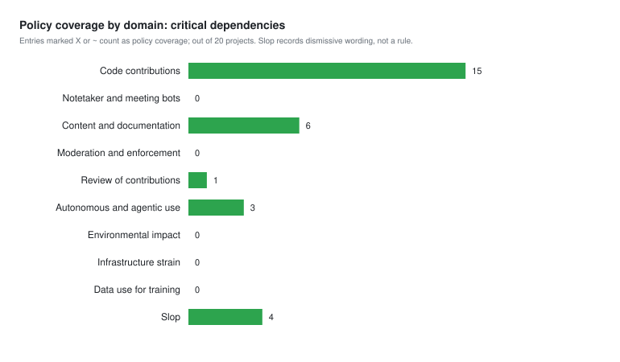
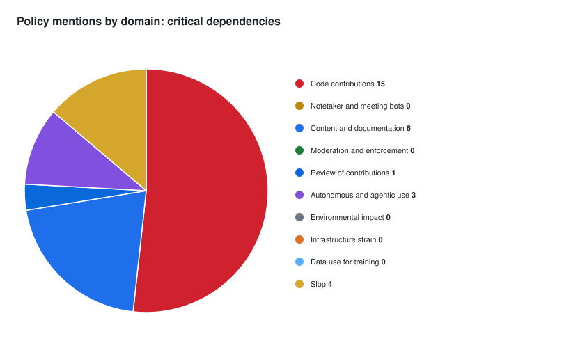

# Critical dependencies: AI policy coverage

Part of the [project cohorts index](../README.md).

## Selection criteria

- **Source:** [ecosyste.ms Critical feed](https://github.com/ecosyste-ms/critical), ranked by dependent repositories. Data retrieved [from the API](https://packages.ecosyste.ms/api/v1/critical?sort=dependent_repos_count&order=desc&per_page=100&page=1) on 2026-10-27.
- **Coverage:** 20 pages (2,000 packages), mapped to 1,514 distinct repositories. The 20th qualifying repository is at position 708.
- **Ranking:** Count each repository once at its highest-ranked package. Positions refer to repositories, not packages.
- **One per owner:** At retrieval, choose the repository with the clearest policy; use feed position to break ties. 122 other qualifying repositories from those feed-mapped owners are omitted.
- **Security-only cases:** Four qualify through security-report guidance only. These are marked in the table and do not count as code-contribution rules.
- **Counts:** The feed measures dependent repositories, not downloads.
- **Moved repository:** `yeoman/update-notifier` has moved to `sindresorhus/update-notifier`, now also the owner of type-fest. The cohort preserves the distinct feed-mapped owners at retrieval; its current repository names therefore include this later owner overlap.

## Sources checked

We checked root files, `docs/`, `doc/`, `.github/`, and agent-config folders, including policies, contribution guides, templates, and other documentation. Each matching passage was reviewed by hand.

We did not check deeper `docs/` paths, organization-level `.github` repositories, websites, wikis, or social posts. For example, typescript-eslint's website policy was not reviewed. Each project report lists its sources.

## Policy coverage by domain

Counts include `X` and `~`; a project may appear in multiple domains. Slop records negative or dismissive wording, not a rule.

| Domain | Projects | Which |
|---|---:|---|
| Code contributions | 15 | yargs/yargs, babel/babel, sindresorhus/type-fest, chimurai/http-proxy-middleware, acornjs/acorn, microsoft/TypeScript, eemeli/yaml, prettier/prettier, csstools/postcss-plugins, gulpjs/interpret, eslint/eslint, mde/ejs, jsdom/jsdom, rollup/rollup, nodeca/argparse |
| Notetaker and meeting bots | 0 | - |
| Content and documentation | 6 | babel/babel, chimurai/http-proxy-middleware, typescript-eslint/typescript-eslint, eemeli/yaml, gulpjs/interpret, eslint/eslint |
| Moderation and enforcement | 0 | - |
| Review of contributions | 1 | eslint/eslint |
| Autonomous and agentic use | 3 | yargs/yargs, microsoft/TypeScript, jsdom/jsdom |
| Environmental impact | 0 | - |
| Infrastructure strain | 0 | - |
| Data use for training | 0 | - |
| Slop | 4 | chalk/supports-color, sindresorhus/type-fest, csstools/postcss-plugins, sindresorhus/update-notifier |

## By file name

Counts include files with a rule, an explicit policy link, or AI-specific instructions. The project reports describe each file's role.

| File name | Count | Projects and the exact file found in |
|---|---:|---|
| SECURITY.md, security.md | 5 | chalk/supports-color: `.github/security.md` sindresorhus/type-fest: `.github/security.md` follow-redirects/follow-redirects: `SECURITY.md` sindresorhus/update-notifier: `.github/security.md` andris9/encoding: `SECURITY.md` |
| AI_POLICY.md, ai-policy.md | 3 | yargs/yargs: `AI_POLICY.md` babel/babel: `AI_POLICY.md` eslint/eslint: `docs/src/contribute/ai-policy.md` |
| CONTRIBUTING.md, contributing.md | 13 | yargs/yargs: `contributing.md` babel/babel: `CONTRIBUTING.md` sindresorhus/type-fest: `.github/contributing.md` acornjs/acorn: `CONTRIBUTING.md` microsoft/TypeScript: `CONTRIBUTING.md` eemeli/yaml: `docs/CONTRIBUTING.md` prettier/prettier: `CONTRIBUTING.md` csstools/postcss-plugins: `CONTRIBUTING.md` eslint/eslint: `CONTRIBUTING.md` mde/ejs: `CONTRIBUTING.md` jsdom/jsdom: `Contributing.md` rollup/rollup: `CONTRIBUTING.md` nodeca/argparse: `CONTRIBUTING.md` |
| AGENTS.md, CLAUDE.md | 6 | babel/babel: `AGENTS.md` chimurai/http-proxy-middleware: `AGENTS.md` eslint/eslint: `AGENTS.md` jsdom/jsdom: `AGENTS.md` andris9/encoding: `CLAUDE.md` rollup/rollup: `AGENTS.md` |
| PULL_REQUEST_TEMPLATE.md, ISSUE_TEMPLATE/* | 5 | chimurai/http-proxy-middleware: `.github/PULL_REQUEST_TEMPLATE.md` typescript-eslint/typescript-eslint: `.github/ISSUE_TEMPLATE/01-bug-report-plugin.yaml` eemeli/yaml: `.github/pull_request_template.md`, `.github/ISSUE_TEMPLATE/bug_report.yaml` prettier/prettier: `.github/PULL_REQUEST_TEMPLATE.md` eslint/eslint: `.github/PULL_REQUEST_TEMPLATE.md` |
| README.md | 1 | gulpjs/interpret: `README.md` |
| AUTHORING_GUIDELINES.md | 1 | csstools/postcss-plugins: `AUTHORING_GUIDELINES.md` |

## Projects

| # | Feed position | Package | Repository | Dependent repositories | Files with AI-related language | Finding | Report |
|---:|---:|---|---|---:|---|---|---|
| 1 | 1 | supports-color | chalk/supports-color | 5,765,200 | [`.github/security.md`](https://github.com/chalk/supports-color/blob/main/.github/security.md) | Security policy rejects “AI slop”; no code-contribution rule identified. | [Report](chalk-supports-color/2026-10-27.md) |
| 2 | 18 | yargs | yargs/yargs | 4,893,685 | [`AI_POLICY.md`](https://github.com/yargs/yargs/blob/main/AI_POLICY.md) [`contributing.md`](https://github.com/yargs/yargs/blob/main/contributing.md) | AI-assisted PRs need a human contributing; mostly or wholly AI-generated PRs and autonomous-agent PRs are not allowed. | [Report](yargs-yargs/2026-10-27.md) |
| 3 | 21 | @babel/types | babel/babel | 4,673,471 | [`AI_POLICY.md`](https://github.com/babel/babel/blob/main/AI_POLICY.md) [`AGENTS.md`](https://github.com/babel/babel/blob/main/AGENTS.md) [`CONTRIBUTING.md`](https://github.com/babel/babel/blob/main/CONTRIBUTING.md) | Policy sets disclosure rules; `AGENTS.md` adds agent-facing PR-description and commit instructions; `CONTRIBUTING.md` links to the policy. | [Report](babel-babel/2026-10-27.md) |
| 4 | 114 | type-fest | sindresorhus/type-fest | 3,278,996 | [`.github/contributing.md`](https://github.com/sindresorhus/type-fest/blob/main/.github/contributing.md) [`.github/security.md`](https://github.com/sindresorhus/type-fest/blob/main/.github/security.md) | Contributing guide encourages AI use for checking types and docs; security policy rejects “AI slop” reports. | [Report](sindresorhus-type-fest/2026-10-27.md) |
| 5 | 148 | http-proxy-middleware | chimurai/http-proxy-middleware | 2,978,280 | [`.github/PULL_REQUEST_TEMPLATE.md`](https://github.com/chimurai/http-proxy-middleware/blob/master/.github/PULL_REQUEST_TEMPLATE.md) [`AGENTS.md`](https://github.com/chimurai/http-proxy-middleware/blob/master/AGENTS.md) | PR template asks for AI disclosure; `AGENTS.md` requires agents to disclose and tag commits. | [Report](chimurai-http-proxy-middleware/2026-10-27.md) |
| 6 | 209 | acorn-walk | acornjs/acorn | 2,651,754 | [`CONTRIBUTING.md`](https://github.com/acornjs/acorn/blob/master/CONTRIBUTING.md) | Code written partially or fully by AI language models is not welcome. | [Report](acornjs-acorn/2026-10-27.md) |
| 7 | 334 | typescript | microsoft/TypeScript | 2,104,747 | [`CONTRIBUTING.md`](https://github.com/microsoft/TypeScript/blob/main/CONTRIBUTING.md) | AI tools allowed with disclosure in the PR; bulk agent-driven contributions are not accepted. | [Report](microsoft-TypeScript/2026-10-27.md) |
| 8 | 360 | follow-redirects | follow-redirects/follow-redirects | 2,023,308 | [`SECURITY.md`](https://github.com/follow-redirects/follow-redirects/blob/main/SECURITY.md) | Security policy: unverified output from scanners, fuzzers and AI tools is not accepted; say if tools were used. | [Report](follow-redirects-follow-redirects/2026-10-27.md) |
| 9 | 390 | @typescript-eslint/parser | typescript-eslint/typescript-eslint | 1,907,734 | [`.github/ISSUE_TEMPLATE/01-bug-report-plugin.yaml`](https://github.com/typescript-eslint/typescript-eslint/blob/main/.github/ISSUE_TEMPLATE/01-bug-report-plugin.yaml) | Issue templates require following the AI Contribution Policy (published on the project website). | [Report](typescript-eslint-typescript-eslint/2026-10-27.md) |
| 10 | 392 | yaml | eemeli/yaml | 1,894,156 | [`docs/CONTRIBUTING.md`](https://github.com/eemeli/yaml/blob/main/docs/CONTRIBUTING.md) [`.github/pull_request_template.md`](https://github.com/eemeli/yaml/blob/main/.github/pull_request_template.md) [`.github/ISSUE_TEMPLATE/bug_report.yaml`](https://github.com/eemeli/yaml/blob/main/.github/ISSUE_TEMPLATE/bug_report.yaml) | Prose must be the author's own; LLM code use must be requested, disclosed and pre-approved. | [Report](eemeli-yaml/2026-10-27.md) |
| 11 | 454 | prettier | prettier/prettier | 1,703,312 | [`CONTRIBUTING.md`](https://github.com/prettier/prettier/blob/main/CONTRIBUTING.md) [`.github/PULL_REQUEST_TEMPLATE.md`](https://github.com/prettier/prettier/blob/main/.github/PULL_REQUEST_TEMPLATE.md) | AI usage policy: understand and test submitted code; low-quality AI content closed; PR template asks about AI use. | [Report](prettier-prettier/2026-10-27.md) |
| 12 | 464 | postcss-custom-properties | csstools/postcss-plugins | 1,661,979 | [`CONTRIBUTING.md`](https://github.com/csstools/postcss-plugins/blob/main/CONTRIBUTING.md) [`AUTHORING_GUIDELINES.md`](https://github.com/csstools/postcss-plugins/blob/main/AUTHORING_GUIDELINES.md) | Contributors are asked not to use LLMs to produce code, pull requests or issues. | [Report](csstools-postcss-plugins/2026-10-27.md) |
| 13 | 482 | interpret | gulpjs/interpret | 1,629,520 | [`README.md`](https://github.com/gulpjs/interpret/blob/main/README.md) | “Strict No LLM / No AI Policy” covering issues, patches and bug-tracker comments. | [Report](gulpjs-interpret/2026-10-27.md) |
| 14 | 502 | eslint | eslint/eslint | 1,569,244 | [`docs/src/contribute/ai-policy.md`](https://github.com/eslint/eslint/blob/main/docs/src/contribute/ai-policy.md) [`CONTRIBUTING.md`](https://github.com/eslint/eslint/blob/main/CONTRIBUTING.md) [`.github/PULL_REQUEST_TEMPLATE.md`](https://github.com/eslint/eslint/blob/main/.github/PULL_REQUEST_TEMPLATE.md) [`AGENTS.md`](https://github.com/eslint/eslint/blob/main/AGENTS.md) | AI Usage Policy: disclosure required, human responsibility, AI-generated PRs only for accepted issues. | [Report](eslint-eslint/2026-10-27.md) |
| 15 | 518 | ejs | mde/ejs | 1,532,080 | [`CONTRIBUTING.md`](https://github.com/mde/ejs/blob/main/CONTRIBUTING.md) | AI help is fine if disclosed; obviously AI-generated PRs from mass-PR accounts are not merged. | [Report](mde-ejs/2026-10-27.md) |
| 16 | 542 | jsdom | jsdom/jsdom | 1,437,647 | [`Contributing.md`](https://github.com/jsdom/jsdom/blob/main/Contributing.md) [`AGENTS.md`](https://github.com/jsdom/jsdom/blob/main/AGENTS.md) | AI-assisted contributions welcome; agent-generated commits need a `Co-authored-by` trailer; human is responsible. | [Report](jsdom-jsdom/2026-10-27.md) |
| 17 | 579 | update-notifier | sindresorhus/update-notifier (was yeoman/update-notifier) | 1,317,099 | [`.github/security.md`](https://github.com/sindresorhus/update-notifier/blob/main/.github/security.md) | Security policy rejects “AI slop”; no code-contribution rule identified. | [Report](yeoman-update-notifier/2026-10-27.md) |
| 18 | 582 | encoding | andris9/encoding | 1,307,827 | [`SECURITY.md`](https://github.com/andris9/encoding/blob/master/SECURITY.md) [`CLAUDE.md`](https://github.com/andris9/encoding/blob/master/CLAUDE.md) | Security policy welcomes AI as a research aid but rejects bulk or unverified AI findings; `CLAUDE.md` agent guidance. | [Report](andris9-encoding/2026-10-27.md) |
| 19 | 653 | rollup | rollup/rollup | 1,133,301 | [`CONTRIBUTING.md`](https://github.com/rollup/rollup/blob/master/CONTRIBUTING.md) [`AGENTS.md`](https://github.com/rollup/rollup/blob/master/AGENTS.md) | AI-created PRs are fine if maintainers may edit them; agents must mark issues and PRs as generated with AI. | [Report](rollup-rollup/2026-10-27.md) |
| 20 | 708 | argparse | nodeca/argparse | 1,075,818 | [`CONTRIBUTING.md`](https://github.com/nodeca/argparse/blob/master/CONTRIBUTING.md) | AI tools may assist, but the submitter must remain the author and be able to explain the change. | [Report](nodeca-argparse/2026-10-27.md) |

## Reviewed and excluded

Positions 1-708 contain 566 other repositories that had no AI-related language in the documents reviewed, or whose only match was not a policy:

- digitalbazaar/forge (143): Only a changelog entry crediting Claude Code for development work; no policy.
- jestjs/jest (197), facebook/jest (364): Changelog entry only.
- reactivex/rxjs (217): Matches are in a design-document folder about AI-assisted migration tooling; no contribution rule found in the files reviewed.
- dotenvx/dotenv-expand (375), motdotla/dotenv (615): Sponsor and agent-skill changelog entries; no policy.
- mcollina/fastq (441), dequelabs/axe-core (630), rails/rails (567): Agent-instruction files that tell an agent how to work in the repository, with no rule on AI use by contributors.
- ai/nanoid (486), postcss/postcss (82), postcss/autoprefixer (116), browserslist/browserslist (44): False positives (an owner named “ai”, a README sponsor line).
- remix-run/react-router (536): Maintainer meeting notes in `GOVERNANCE.md` discuss AI-generated pull requests but do not state a rule.
- jaredwray/cacheable (547), jaredwray/keyv (706): Agent-skill references and security-tooling notes; no AI-use policy.

Generated 2026-10-27; 20 project reports.
