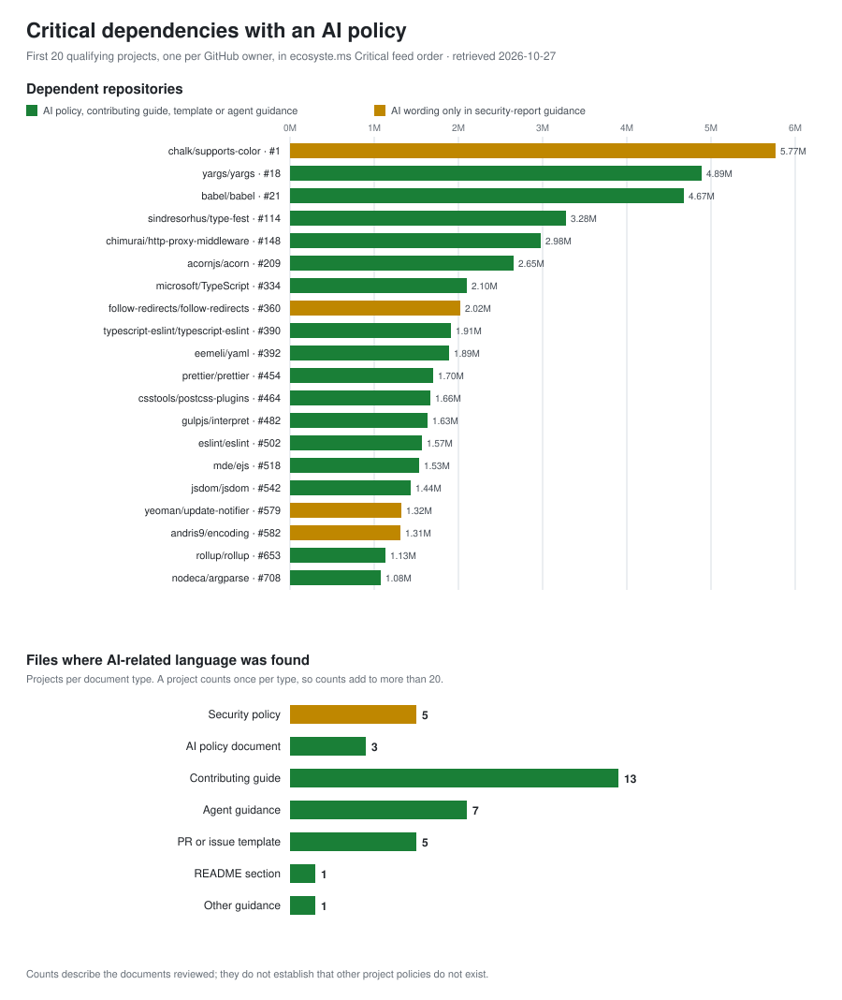

# Critical dependencies: AI policy coverage

Part of the [project cohorts index](../README.md).

This cohort is the first 20 projects **with an AI-related policy** among the packages ranked highest by dependent repository count in [ecosyste.ms' Critical feed](https://github.com/ecosyste-ms/critical), retrieved from the [Critical API](https://packages.ecosyste.ms/api/v1/critical?sort=dependent_repos_count&order=desc&per_page=100&page=1) on 2026-10-27. The ranking uses the feed's `dependent_repos_count` field in descending order (`sort=dependent_repos_count`, `order=desc`, `per_page=100`, pages 1-20, 2,000 package records). Packages were mapped to their GitHub repositories, and a repository that backs several packages is counted once at its highest-ranked package, giving 1,514 distinct repositories. Repositories were taken in feed order until 20 qualified; the 20th qualifier is at feed position 708. Position numbers below are positions among distinct repositories, not package record numbers.

**One project per GitHub owner.** Several owners publish many popular packages with identical policy files, which would crowd the list. Each owner appears once. Where an owner has several qualifying repositories, the one with the most substantive AI language is shown (a dedicated AI policy or contributing guidance over a one-line security-report sentence), with feed position as the tie-break. 122 further repositories from owners already in the cohort also had AI-related language and are not listed separately (for example `chalk/wrap-ansi`, `yargs/yargs-parser`, `sindresorhus/camelcase`, `sindresorhus/globby`, `nodeca/js-yaml`).

A repository qualifies when an official project document contains explicit AI-related wording: a rule, requirement, permission, restriction, or guidance. Four qualify only through a security-report sentence about AI; that wording is scoped to vulnerability reports and is not treated as a project-wide rule on AI-assisted code. They are marked separately in the chart and table. Feed figures are dependent repositories, not downloads.

## Documents reviewed

For each repository the file tree was listed and every documentation-type file at the repository root, and in `docs/`, `doc/` and `.github/`, was read and searched for AI-related terms (AI, LLM, large language model, ChatGPT, Copilot, Claude, Gemini, Codex, Cursor, generative, agentic, autonomous agent, machine-generated and related phrases). That covers README, CONTRIBUTING, CODE_OF_CONDUCT, SECURITY, GOVERNANCE, FAQ, `AI_POLICY.md`, `AGENTS.md` and `CLAUDE.md`, pull-request and issue templates, and other Markdown, text and reStructuredText files in those locations. Every match was then read by hand. Not covered: paths nested more than one level under `docs/`, organization-level `.github` repositories, project websites, wikis, and social posts. A policy that lives only there would have been missed; for example, typescript-eslint's AI Contribution Policy is published on its website and was not read. Each report lists the documents it relied on.

[View the SVG chart](critical-dependencies.svg).

## By document type

| Document type | Count | Projects |
|---|---:|---|
| Security policy | 5 | chalk/supports-color, sindresorhus/type-fest, follow-redirects/follow-redirects, yeoman/update-notifier, andris9/encoding |
| AI policy document | 3 | yargs/yargs, babel/babel, eslint/eslint |
| Contributing guide | 13 | yargs/yargs, babel/babel, sindresorhus/type-fest, acornjs/acorn, microsoft/TypeScript, eemeli/yaml, prettier/prettier, csstools/postcss-plugins, eslint/eslint, mde/ejs, jsdom/jsdom, rollup/rollup, nodeca/argparse |
| Agent guidance | 7 | babel/babel, sindresorhus/type-fest, chimurai/http-proxy-middleware, eslint/eslint, jsdom/jsdom, andris9/encoding, rollup/rollup |
| PR or issue template | 5 | chimurai/http-proxy-middleware, typescript-eslint/typescript-eslint, eemeli/yaml, prettier/prettier, eslint/eslint |
| README section | 1 | gulpjs/interpret |
| Other guidance | 1 | csstools/postcss-plugins |

## Slop domain

The grid has a tenth domain, **Slop**: wording in a project's own policy text that is negative or dismissive of AI as a technology or of its output in general. It records attitude, not a rule, so supervision, scope and accountability are left blank. 4 of the 20 use such wording: chalk/supports-color, sindresorhus/type-fest, csstools/postcss-plugins, yeoman/update-notifier. Neutral quality language, such as prettier's “Low-quality AI content will be closed immediately.”, was not counted. The check searched the AI-related documents above for terms such as slop, garbage, junk, mediocre and spam, then read each match.

## Projects

| # | Feed position | Package | Repository | Dependent repositories | Where found | Finding | Report |
|---:|---:|---|---|---:|---|---|---|
| 1 | 1 | supports-color | chalk/supports-color | 5,765,200 | Security policy | Security policy rejects “AI slop”; no code-contribution rule identified. | [Report](chalk-supports-color/2026-10-27.md) |
| 2 | 18 | yargs | yargs/yargs | 4,893,685 | AI policy document, Contributing guide | AI-assisted PRs need a human contributing; mostly or wholly AI-generated PRs and autonomous-agent PRs are not allowed. | [Report](yargs-yargs/2026-10-27.md) |
| 3 | 21 | @babel/types | babel/babel | 4,673,471 | AI policy document, Contributing guide, Agent guidance | AI use allowed with limits; LLM-generated commits and prose must be disclosed; entirely LLM-generated PRs are not allowed. | [Report](babel-babel/2026-10-27.md) |
| 4 | 114 | type-fest | sindresorhus/type-fest | 3,278,996 | Security policy, Contributing guide, Agent guidance | Contributing guide encourages AI use for checking types and docs; security policy rejects “AI slop” reports. | [Report](sindresorhus-type-fest/2026-10-27.md) |
| 5 | 148 | http-proxy-middleware | chimurai/http-proxy-middleware | 2,978,280 | Agent guidance, PR or issue template | PR template asks for AI disclosure; `AGENTS.md` requires agents to disclose and tag commits. | [Report](chimurai-http-proxy-middleware/2026-10-27.md) |
| 6 | 209 | acorn-walk | acornjs/acorn | 2,651,754 | Contributing guide | Code written partially or fully by AI language models is not welcome. | [Report](acornjs-acorn/2026-10-27.md) |
| 7 | 334 | typescript | microsoft/TypeScript | 2,104,747 | Contributing guide | AI tools allowed with disclosure in the PR; bulk agent-driven contributions are not accepted. | [Report](microsoft-TypeScript/2026-10-27.md) |
| 8 | 360 | follow-redirects | follow-redirects/follow-redirects | 2,023,308 | Security policy | Security policy: unverified output from scanners, fuzzers and AI tools is not accepted; say if tools were used. | [Report](follow-redirects-follow-redirects/2026-10-27.md) |
| 9 | 390 | @typescript-eslint/parser | typescript-eslint/typescript-eslint | 1,907,734 | PR or issue template | Issue templates require following the AI Contribution Policy (published on the project website). | [Report](typescript-eslint-typescript-eslint/2026-10-27.md) |
| 10 | 392 | yaml | eemeli/yaml | 1,894,156 | Contributing guide, PR or issue template | Prose must be the author's own; LLM code use must be requested, disclosed and pre-approved. | [Report](eemeli-yaml/2026-10-27.md) |
| 11 | 454 | prettier | prettier/prettier | 1,703,312 | Contributing guide, PR or issue template | AI usage policy: understand and test submitted code; low-quality AI content closed; PR template asks about AI use. | [Report](prettier-prettier/2026-10-27.md) |
| 12 | 464 | postcss-custom-properties | csstools/postcss-plugins | 1,661,979 | Contributing guide, Other guidance | Contributors are asked not to use LLMs to produce code, pull requests or issues. | [Report](csstools-postcss-plugins/2026-10-27.md) |
| 13 | 482 | interpret | gulpjs/interpret | 1,629,520 | README section | “Strict No LLM / No AI Policy” covering issues, patches and bug-tracker comments. | [Report](gulpjs-interpret/2026-10-27.md) |
| 14 | 502 | eslint | eslint/eslint | 1,569,244 | AI policy document, Contributing guide, Agent guidance, PR or issue template | AI Usage Policy: disclosure required, human responsibility, AI-generated PRs only for accepted issues. | [Report](eslint-eslint/2026-10-27.md) |
| 15 | 518 | ejs | mde/ejs | 1,532,080 | Contributing guide | AI help is fine if disclosed; obviously AI-generated PRs from mass-PR accounts are not merged. | [Report](mde-ejs/2026-10-27.md) |
| 16 | 542 | jsdom | jsdom/jsdom | 1,437,647 | Contributing guide, Agent guidance | AI-assisted contributions welcome; agent-generated commits need a `Co-authored-by` trailer; human is responsible. | [Report](jsdom-jsdom/2026-10-27.md) |
| 17 | 579 | update-notifier | yeoman/update-notifier | 1,317,099 | Security policy | Security policy rejects “AI slop”; no code-contribution rule identified. | [Report](yeoman-update-notifier/2026-10-27.md) |
| 18 | 582 | encoding | andris9/encoding | 1,307,827 | Security policy, Agent guidance | Security policy welcomes AI as a research aid but rejects bulk or unverified AI findings; `CLAUDE.md` agent guidance. | [Report](andris9-encoding/2026-10-27.md) |
| 19 | 653 | rollup | rollup/rollup | 1,133,301 | Contributing guide, Agent guidance | AI-created PRs are fine if maintainers may edit them; agents must mark issues and PRs as generated with AI. | [Report](rollup-rollup/2026-10-27.md) |
| 20 | 708 | argparse | nodeca/argparse | 1,075,818 | Contributing guide | AI tools may assist, but the submitter must remain the author and be able to explain the change. | [Report](nodeca-argparse/2026-10-27.md) |

## Reviewed and excluded

Positions 1-708 contain 566 other repositories that had no AI-related language in the documents reviewed, or whose only match was not a policy:

- digitalbazaar/forge (143): Only a changelog entry crediting Claude Code for development work; no policy.
- jestjs/jest (197), facebook/jest (364): Changelog entry only.
- reactivex/rxjs (217): Matches are in a design-document folder about AI-assisted migration tooling; no contribution rule found in the files reviewed.
- dotenvx/dotenv-expand (375), motdotla/dotenv (615): Sponsor and agent-skill changelog entries; no policy.
- mcollina/fastq (441), dequelabs/axe-core (630), rails/rails (567): Agent-instruction files that tell an agent how to work in the repository, with no rule on AI use by contributors.
- ai/nanoid (486), postcss/postcss (82), postcss/autoprefixer (116), browserslist/browserslist (44): False positives (an owner named “ai”, a README sponsor line).
- remix-run/react-router (536): Maintainer meeting notes in `GOVERNANCE.md` discuss AI-generated pull requests but do not state a rule.
- jaredwray/cacheable (547), jaredwray/keyv (706): Agent-skill references and security-tooling notes; no AI-use policy.

Generated 2026-10-27; 20 project reports.
